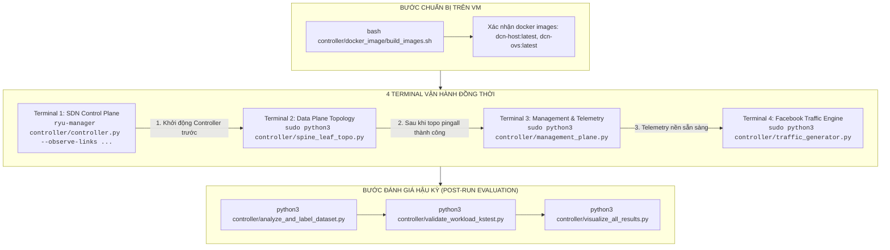

# CÂY THƯ MỤC DỰ ÁN (PROJECT FILE TREE)

> **Đề tài:** Research on Traffic Engineering Optimization in Data Center Networks Based on Software-Defined Network and Artificial Intelligence (SDN KLTN)
> **Kiến trúc mạng:** Multi-tier Clos Spine-Leaf 2 Cụm (Facebook ACM SIGCOMM 2015: 14 Switches, 32 Hosts [4 hosts/rack], 1 Egress Gateway)
> **Cập nhật lần cuối:** 2026-10-18
> **Cố vấn kỹ thuật:** Senior SDN Architect (Gemini 4 Argon)

---

## 🏷️ BẢNG CHÚ GIẢI NHÃN PHÂN LOẠI TỆP TIN (FILE CLASSIFICATION BADGES)

| Ký hiệu | Nhãn phân loại         | Ý nghĩa & Môi trường thực thi                                                                                                                                   |
| :-----: | :--------------------- | :-------------------------------------------------------------------------------------------------------------------------------------------------------------- |
|   ⚡    | **`[VM RUNTIME]`**     | **Tệp cốt lõi bắt buộc nạp & thực thi trên Máy ảo (VM Ubuntu Containernet)**. Bao gồm Controller, Topology, Management Plane, eBPF Telemetry và Traffic Engine. |
|   ⚙️    | **`[CONFIG / IaC]`**   | **Tệp cấu hình hạ tầng & lưu lượng (IaC)**. Nạp trực tiếp vào runtime của VM qua JSON Pointer (`ref:`).                                                         |
|   ⚙️    | **`[RUNTIME DATA]`**   | **Hồ sơ phân phối thực nghiệm ECDF đã hòa trộn chuẩn SI**. Đọc trực tiếp bởi bộ lấy mẫu toán học trên VM.                                                       |
|   🐳    | **`[VM SETUP]`**       | **Tệp xây dựng Docker Image trên VM**. Dùng để build môi trường cô lập cho Host và Switch OVS.                                                                  |
|   📊    | **`[POST-RUN EVAL]`**  | **Script đánh giá, gán nhãn AI & vẽ biểu đồ sau thực nghiệm**. Chạy trên VM hoặc máy host sau khi thu thập xong telemetry.                                      |
|   📖    | **`[GUIDE / DOC]`**    | **Tài liệu hướng dẫn thực nghiệm & quy chuẩn vận hành 4 terminal**.                                                                                             |
|   📦    | **`[OFFLINE SUPPLY]`** | **Thư mục bổ trợ tiền xử lý số hóa offline & dữ liệu thô**. Đã hoàn thành nhiệm vụ số hóa từ PDF bài báo Facebook; **KHÔNG CẦN CHẠY TRÊN VM**.                  |
|   🧠    | **`[AGENT SKILL]`**    | **Kỹ năng điều khiển hành vi & quy chuẩn nhận thức của Agent** (`.antigravity/skills/`). Giữ repo luôn sạch sẽ, truy vết và tự động hóa.                        |
|   🛠️    | **`[DOMAIN SKILL]`**   | **Kỹ năng nghiệp vụ DCN/AI chuyên sâu** (`containernet`, `ryu`, `ml-classifier`, `drl-gym`) được Agent kích hoạt theo bài toán.                                 |

---

## 🌳 CẤU TRÚC CÂY THƯ MỤC CHI TIẾT (PROJECT TREE)

```
SDN KLTN/
├── .Project Plans/                               # Kế hoạch nghiên cứu, đặc tả toán học & kiểm chứng học thuật
│   ├── UNIFIED_DCN_TRAFFIC_SIMULATION_MASTER_PLAN.md # Kế hoạch tổng thể sinh tải thống nhất Facebook DCN (SIGCOMM 2015)
│   ├── PROJECT_MASTER_PLAN_SUMMARY.md            # Bản đồ tổng quan toàn bộ dự án & tích hợp ECN Microburst
│   ├── PROJECT_COMPLETED_ACHIEVEMENTS.md         # Báo cáo 8 chương chi tiết công thức, thuật toán, công cụ & cơ chế
│   ├── TRAFFIC_SIMULATION_CHECKLIST.md           # Bảng theo dõi tiến độ & nghiệm thu 8 giai đoạn sinh tải
│   ├── detail_plan.md                            # Kế hoạch chi tiết kiến trúc 4 tầng & kịch bản kiểm nghiệm TE
│   ├── overview plan.md                          # Kế hoạch tổng quan ban đầu của đề tài
│   ├── Updated_Plan/                             # 📚 THƯ VIỆN KẾ HOẠCH CẬP NHẬT CHUẨN HỌC THUẬT (SYSTEM DESIGN DOCUMENTS)
│   │   ├── 00_PROJECT_OVERALL_MASTER_PLAN.md     # 🌟 Kế hoạch tổng thể toàn bộ đề tài KLTN (Bối cảnh DCN, Kiến trúc 4 tầng, Roadmap)
│   │   ├── 01_DATA_PLANE_TOPOLOGY_INFRASTRUCTURE_PLAN.md # WP01: Hạ tầng 2-Cluster Clos, OVS Datapath, Đồng dạng BDP, ECN Reflex K=30KB
│   │   ├── 02_SDN_CONTROL_PLANE_OPENFLOW_PIPELINE_PLAN.md # WP02: Ryu Controller OpenFlow 1.3 Multi-Table Pipeline, Proxy ARP, Steering
│   │   ├── 03_UNIFIED_TRAFFIC_SIMULATION_ENGINE_PLAN.md # WP03: Động cơ sinh tải Facebook SIGCOMM 2015, ECDF Inversion, KS-Test
│   │   ├── 04_DEEP_TELEMETRY_EBPF_MANAGEMENT_PLANE_PLAN.md # WP04: eBPF/XDP Kernel Hook, Perf Ring Buffer, 10 Bi-flow Features, 5 CSVs
│   │   ├── 05_AI_EARLY_FLOW_CLASSIFIER_PLAN.md   # WP05: Tầng Học Máy - Mô hình phân loại luồng sớm XGBoost/LightGBM dưới 1ms
│   │   ├── 06_INTELLIGENT_ROUTING_GAT_PPO_DRL_PLAN.md # WP06: Tầng Định tuyến - Graph Attention Network kết hợp PPO DRL đa đường
│   │   ├── 07_IN_NETWORK_NFV_PROXY_PACKET_REASSEMBLY_PLAN.md # WP07: Ứng dụng nhúng NFV Proxy phân mảnh 64KB & tái hợp chống out-of-order
│   │   └── 08_PERFORMANCE_EVALUATION_ACADEMIC_BENCHMARK_PLAN.md # WP08: Thực nghiệm đối sánh 5 kịch bản & tiêu chí đánh giá học thuật
│   ├── PROJECT_ARCHITECTURE_MAP.md               # Sơ đồ quan hệ kiến trúc toàn project sinh tự động bằng Mermaid (Dynamic AST)
│   ├── ARCHITECTURE_EXPLORER.html                # 🌐 Ứng dụng Web Đồ họa Tương tác Toàn project (Pan/Zoom vô cực, Node Inspector, 100% Offline)
│   └── ADR/                                      # Biên bản quyết định kiến trúc then chốt (Architecture Decision Records)
│       └── ADR-001-ecn-miceflow-fastpath.md      # ADR-001: Xử lý Microburst theo hướng Miceflow bằng ECN tại Data Plane [APPROVED]
│
├── controller/                                   # MẶT PHẲNG ĐIỀU KHIỂN & ĐỘNG CƠ THỰC NGHIỆM DCN (CHÍNH)
│   │
│   │── [NHÓM 1: MÃ NGUỒN VẬN HÀNH TRÊN MÁY ẢO VM - CORE RUNTIME]
│   ├── controller.py                             # ⚡ [VM RUNTIME / TERMINAL 1] Ryu SDN Controller OpenFlow 1.3 (Pipeline 2 bảng, LLDP Debounce, Dynamic Discovery, Proxy ARP, Bi-flow Rules, ECN Counter)
│   ├── spine_leaf_topo.py                        # ⚡ [VM RUNTIME / TERMINAL 2] Containernet Topo 2 Cụm Clos (14 Switch OVS, 32 Docker Hosts, RED/ECN Queue qdisc min=30KB, Host Cgroups)
│   ├── management_plane.py                       # ⚡ [VM RUNTIME / TERMINAL 3] Tầng Quản trị & Telemetry Toàn diện (Bi-flow 10 features, Hop-by-Hop Trace, Background Docker Stats, Link/Health Telemetry, KPI CSVs)
│   ├── traffic_generator.py                      # ⚡ [VM RUNTIME / TERMINAL 4] Engine Sinh tải Nền Thống nhất Facebook (ThreadPoolExecutor, 4 cấp Locality, Tỷ lệ UDP 18.4% / TCP 81.6%)
│   ├── dcn_flow_engine.py                        # ⚡ [VM RUNTIME] Động cơ Socket TCP/UDP Client/Server chính xác cấp byte (TCP_NODELAY, Packet Size ECDF, Timeout an toàn)
│   ├── unified_sampler.py                        # ⚡ [VM RUNTIME] Module Toán học Lấy mẫu ECDF (Inverse Sampling, Continuous Scaling, Time Dilation, Tái lặp Seed)
│   ├── microburst_generator.py                   # ⚡ [VM RUNTIME] Module Bơm Heavy Jitter / Microburst & Incast (< 10ms, Cờ ECN ECT-0, Ghi nhật ký Client Ground-Truth)
│   ├── ebpf_telemetry.c                          # ⚡ [VM RUNTIME] Chương trình eBPF/XDP In-Kernel C (Bắt Microburst 10ms, Đo FCT nano-giây, Đếm cờ ECN CE ip->tos & 0x03)
│   ├── ebpf_loader.py                            # ⚡ [VM RUNTIME] Python eBPF Loader & Perf Ring Buffer Reader (Xuất sự kiện microburst trực tiếp cho Management Plane)
│   │
│   │── [NHÓM 2: CẤU HÌNH THAM CHIẾU ĐỘNG & HỒ SƠ DỮ LIỆU RUNTIME - CONFIG & DATA]
│   ├── topology_config.json                      # ⚙️ [CONFIG / IaC] Cấu hình mặt phẳng hạ tầng tĩnh (DPID, MAC, Port, Link Bandwidth, Cgroups CPU/RAM limits)
│   ├── traffic_config.json                       # ⚙️ [CONFIG / TRAFFIC] Cấu hình mặt phẳng lưu lượng (Quản trị tập trung: Ngưỡng ECN K = 30KB, 4 Locality levels, Elephant Flow Threshold)
│   ├── cdf_profiles/                             # ⚙️ [RUNTIME DATA] Thư mục chứa 3 hồ sơ phân phối ECDF thống nhất đã hòa trộn chuẩn SI
│   │   ├── cdf_flow_size_unified.csv             # ⚙️ [RUNTIME DATA] Kích thước luồng hòa trộn SI [84 B -> 55.8 MB]
│   │   ├── cdf_inter_arrival_unified.csv         # ⚙️ [RUNTIME DATA] Khoảng cách phát hòa trộn SI [11 us -> 0.17 s]
│   │   └── cdf_flow_duration_unified.csv         # ⚙️ [RUNTIME DATA] Thời lượng luồng hòa trộn SI [1.1 ms -> 327.3 s]
│   │
│   │── [NHÓM 3: KHỞI TẠO MÔI TRƯỜNG VIRTUAL MACHINE - DOCKER SETUP]
│   ├── docker_image/                             # 🐳 [VM SETUP] Thư mục kịch bản và cấu hình xây dựng Container cho Topo
│   │   ├── Dockerfile.host                       # 🐳 [VM SETUP] Dockerfile máy trạm dcn-host:latest (iproute2, iperf3, ethtool, net-tools, python3)
│   │   ├── Dockerfile.ovs                        # 🐳 [VM SETUP] Dockerfile switch OVS dcn-ovs:latest nhúng NFV Proxy
│   │   ├── entrypoint_ovs.sh                     # 🐳 [VM SETUP] Entrypoint khởi tạo ovsdb-server, ovs-vswitchd và cổng proxy-int nội bộ
│   │   └── build_images.sh                       # 🐳 [VM SETUP] Bash script tự động build cả 2 Docker image trên VM
│   │
│   │── [NHÓM 4: ĐÁNH GIÁ HẬU KỲ & TRỰC QUAN HÓA - POST-RUN EVALUATION]
│   ├── analyze_and_label_dataset.py              # 📊 [POST-RUN EVAL] Phân tích phân vị Pareto (P90/P95), xác định S_threshold = 280KB & gán nhãn Ground-Truth (1: Elephant, 0: Mice)
│   ├── validate_workload_kstest.py               # 📊 [POST-RUN EVAL] Kiểm định thống kê 2 mẫu Kolmogorov-Smirnov (p-value > 0.05, chứng minh đồng nhất với phân bố Facebook)
│   ├── visualize_all_results.py                  # 📊 [POST-RUN EVAL] Xuất 5 biểu đồ học thuật độ nét cao 300 DPI (Bisection, Hop-count, ECN CE drops, FCT, KS-Test)
│   ├── TESTING_AND_OVERHAUL_GUIDE.md             # 📖 [GUIDE] Cẩm nang chi tiết hướng dẫn vận hành 4 terminal & kiểm tra toàn diện hệ thống
│   ├── README.md                                 # 📖 [DOC] Tài liệu giới thiệu tổng quan tầng điều khiển SDN
│   │
│   └── supply/                                   # 📦 [OFFLINE SUPPLY] THƯ MỤC BỔ TRỢ TIỀN XỬ LÝ SỐ HÓA OFFLINE & DỮ LIỆU THÔ (KHÔNG CHẠY TRÊN VM)
│       ├── extract_paper_figures.py              # 📦 [OFFLINE] Trích xuất ảnh biểu đồ 400 DPI từ file PDF bài báo Facebook SIGCOMM 2015
│       ├── digitize_paper_plots.py               # 📦 [OFFLINE] Thuật toán Backward Curve Tracking số hóa 9 đường thực nghiệm sang CSV thô
│       ├── blend_cdfs.py                         # 📦 [OFFLINE] Thuật toán hòa trộn tổ hợp lồi trên miền logarit (Hadoop 42.8%, Web 38.8%, Cache 18.4%)
│       ├── tcp_flow_server.py                    # 📦 [OFFLINE] Script prototype TCP server cũ phục vụ kiểm thử ban đầu
│       ├── fig1_0.png                            # 📦 [OFFLINE] Ảnh sơ đồ cụm DCN Facebook trích xuất tham khảo
│       ├── extracted_figures/                    # 📦 [OFFLINE] Thư mục chứa 12 ảnh biểu đồ cắt từ PDF bài báo độ nét cao 400 DPI
│       └── raw_digitized/                        # 📦 [OFFLINE] Thư mục chứa 9 tệp CSV số hóa thô theo đơn vị gốc bài báo
│           ├── flow_size/                        # 3 CSV kích thước luồng (KB)
│           ├── flow_duration/                    # 3 CSV thời lượng luồng (ms)
│           └── inter_arrival/                    # 3 CSV khoảng cách phát (usec)
│
├── results/                                      # KẾT QUẢ ĐO ĐẠC, DATASETS, TELEMETRY & BIỂU ĐỒ HỌC THUẬT (ĐẦU RA CỦA VM)
│   ├── traffic_flow_dataset_with_paths.csv       # Dataset luồng với 10 features & hop-by-hop path phục vụ huấn luyện AI
│   ├── final_labeled_flow_dataset.csv            # Dataset đã gán nhãn chuẩn Ground-Truth (1: Elephant, 0: Mice)
│   ├── device_resource_utilization.csv           # Telemetry tài nguyên switch OVS & docker hosts (CPU %, RAM MB, Net IO Mbps, Drops, TCAM)
│   ├── system_and_network_health.csv             # Giám sát sức khỏe chi tiết theo chu kỳ thời gian thực của toàn bộ nodes
│   ├── link_utilization_telemetry.csv            # Telemetry liên kết (Throughput Mbps, Capacity, Utilization %, Drop delta)
│   ├── network_evaluation_kpis.csv               # Chỉ số KPI học thuật (Throughput, Bisection %, Loss %, Jain's Fairness, Std Dev)
│   ├── microburst_client_ground_truth.csv        # Nhật ký ground-truth phát microburst phía client
│   ├── flow_distribution_and_threshold_analysis.png # Biểu đồ phân tích phân vị P90/P95 và phân bố tải (300 DPI)
│   ├── chart_facebook_workload_validation.png    # Biểu đồ so sánh chồng hình & kết quả kiểm định KS-Test (300 DPI)
│   └── digitization_verification/                # Biểu đồ kiểm chứng số hóa
│       ├── digitized_9_curves_validation.png     # Đồ thị 9 đường ECDF số hóa đầy đủ heavy-tail chạm CDF = 1.0
│       └── blended_unified_cdfs.png              # Đồ thị 3 đường hòa trộn thống nhất đại diện
│
├── ml_engine/                                    # TẦNG HỌC MÁY - AI / MACHINE LEARNING ENGINE
│   ├── classifier/                               # Phân loại luồng sớm (Random Forest / XGBoost / LightGBM)
│   │   └── README.md
│   └── routing/                                  # Điều phối định tuyến thông minh (Graph Attention Network + PPO DRL)
│       └── README.md
│
├── nfv_proxy/                                    # ỨNG DỤNG NHÚNG NFV PROXY TRÊN SWITCH ACCESS (CỔNG PROXY-INT)
│   └── README.md                                 # Phân mảnh block 64KB & tái hợp gói chống out-of-order TCP
│
├── data_plane/                                   # MÃ NGUỒN VÀ KỊCH BẢN KHỞI CHẠY DATA PLANE
│   └── README.md
│
├── evaluate/                                     # KỊCH BẢN KIỂM THỬ HIỆU NĂNG & BENCHMARK (ECMP vs SDN-AI)
│   └── README.md
│
├── Dataset/                                      # CÁC TẬP DỮ LIỆU MẠNG THAM KHẢO BAN ĐẦU (InSDN, SDN Dataset...)
│   ├── InSDN_DatasetCSV/
│   ├── SDN Dataset/
│   └── SDN_Dataset-main/
│
├── Documents/                                    # TÀI LIỆU NGHIÊN CỨU & BÀI BÁO KHOA HỌC ACM/IEEE
│   ├── Inside the Social Network's (Datacenter) Network.pdf # Bài báo gốc Facebook ACM SIGCOMM 2015
│   └── Sumary/                                   # Tóm tắt 16 bài báo khoa học liên quan
│
├── .antigravity/                                  # HỆ THỐNG TÙY BIẾN, LUẬT LỆ & KỸ NĂNG AGENT (CUSTOMIZATION ROOT)
│   ├── agents.json                               # Đăng ký vai trò Cố vấn Kỹ thuật cao cấp (Critical Reviewer - Argon)
│   ├── rules/                                    # Quy chuẩn viết mã luôn bật (Always-on Rules)
│   │   └── clean-code.md                         # Bộ quy tắc Clean Code bắt buộc của dự án SDN KLTN
│   └── skills/                                   # Hệ sinh thái 10 Kỹ năng chuyên biệt (5 Nghiệp vụ + 5 Hành vi Agent)
│       ├── clean-code/                           # 🧠 [HYGIENE] Chốt chặn Pre-commit & Script kiểm tra verify_hygiene.py
│       ├── agent-changelog-keeper/               # 🧠 [META] Tự động ghi chép nhật ký CHANGELOG theo chuẩn quốc tế
│       ├── code-architecture-mapper/             # 🧠 [META] Tự động quét AST/Import & vẽ sơ đồ kiến trúc Mermaid
│       ├── adr-decision-recorder/                # 🧠 [META] Ghi nhận quyết định kiến trúc then chốt (ADR)
│       ├── doc-code-synchronizer/                # 🧠 [META] Tự động đồng bộ tài liệu, .FileTree.md chống lệch pha
│       ├── argon-advisory-protocol/              # 🧠 [META] Quy chuẩn tham vấn, phản biện & nghiệm thu với Cố vấn Argon
│       ├── containernet-topo-design/             # 🛠️ [DOMAIN] Thiết kế topo 2 Cụm Clos, Cgroups, TCLink
│       ├── ryu-app-development/                 # 🛠️ [DOMAIN] Lập trình Ryu OpenFlow 1.3, Multi-Table, Group Table
│       ├── ml-classifier-pipeline/               # 🛠️ [DOMAIN] Huấn luyện mô hình phân loại luồng Voi/Chuột sớm
│       └── drl-gym-environment/                  # 🛠️ [DOMAIN] Môi trường Gymnasium GNN-GAT + DRL PPO Routing
│
├── launch_architecture_viewer.py                 # 🌐 Trình khởi chạy 1-click mở ứng dụng tương tác ARCHITECTURE_EXPLORER.html
├── topology.py                                   # Script mô hình mạng Containernet mẫu thử nghiệm ban đầu
└── .FileTree.md                                  # Cây thư mục dự án & Bảng phân loại vận hành VM (Tệp này)
```

---

## 🚀 QUY TRÌNH THỰC THI 4 TERMINAL TRÊN MÁY ẢO VM (VM 4-TERMINAL RUNBOOK)

Sau khi đưa toàn bộ mã nguồn vào máy ảo Ubuntu Containernet, người dùng thực hiện theo đúng thứ tự 4 terminal sau:



### Chi tiết câu lệnh từng Terminal:

1. **Terminal 1: Khởi động Ryu SDN Controller**

   ```bash
   cd ~/SDN\ KLTN/controller
   ryu-manager --observe-links controller.py ryu.app.ofctl_rest ryu.app.rest_topology --ofp-tcp-listen-port 6653
   ```

2. **Terminal 2: Khởi tạo Containernet Topology (2 Cụm Clos, 14 Switch, 32 Host)**

   ```bash
   cd ~/SDN\ KLTN/controller
   sudo python3 spine_leaf_topo.py
   # Khi vào CLI mininet>, thực hiện:
   mininet> pingall
   ```

3. **Terminal 3: Khởi chạy Tầng Quản trị, eBPF & Thu thập Telemetry Toàn diện**

   ```bash
   cd ~/SDN\ KLTN/controller
   sudo python3 management_plane.py
   ```

4. **Terminal 4: Bơm Lưu lượng Chuẩn Facebook Workload & Heavy Jitter Microburst**

   ```bash
   cd ~/SDN\ KLTN/controller
   sudo python3 traffic_generator.py

   # (Tùy chọn phụ trợ bơm Incast/Microburst cường độ cao):
   sudo python3 microburst_generator.py
   ```

5. **Đánh giá Hậu kỳ & Xuất Báo cáo Học thuật (Sau khi kết thúc sinh tải):**

   ```bash
   cd ~/SDN\ KLTN/controller
   python3 analyze_and_label_dataset.py   # Phân vị Pareto P90/P95, gán nhãn Ground-Truth
   python3 validate_workload_kstest.py    # Kiểm định Kolmogorov-Smirnov 2 mẫu
   python3 visualize_all_results.py       # Xuất 5 biểu đồ nét cao 300 DPI
   ```

---

## 📌 GIẢI TRÌNH VAI TRÒ THƯ MỤC `controller/supply/`

Thư mục `controller/supply/` được thiết kế nhằm **tách biệt rạch ròi** giữa môi trường thực nghiệm trực tiếp và các tác vụ tiền xử lý ngoại tuyến (offline preprocessing):

1. **Không phụ thuộc khi chạy thực nghiệm trên VM:**Toàn bộ các tệp trong `controller/supply/` (`extract_paper_figures.py`, `digitize_paper_plots.py`, `blend_cdfs.py`, `tcp_flow_server.py`, `fig1_0.png`, `extracted_figures/`, `raw_digitized/`) **không bao giờ được gọi tại runtime** của mạng DCN.
2. **Dữ liệu đầu vào runtime đã được chuẩn bị sẵn:**Kết quả của quá trình số hóa và hòa trộn ECDF đã được lưu trữ sẵn sàng dưới dạng chuẩn SI trong thư mục `controller/cdf_profiles/` (`cdf_flow_size_unified.csv`, `cdf_inter_arrival_unified.csv`, `cdf_flow_duration_unified.csv`).
3. **Tính độc lập & Tự đóng gói (Self-contained):**
   Các đường dẫn trong `blend_cdfs.py`, `digitize_paper_plots.py`, và `extract_paper_figures.py` đã được tái cấu trúc bằng `os.path.dirname(os.path.abspath(__file__))`, cho phép tái tạo lại toàn bộ quá trình số hóa từ file PDF gốc bất cứ lúc nào mà không gây xung đột thư mục làm việc của VM.
