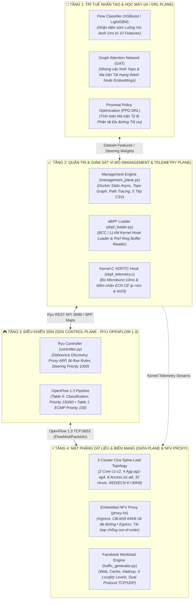
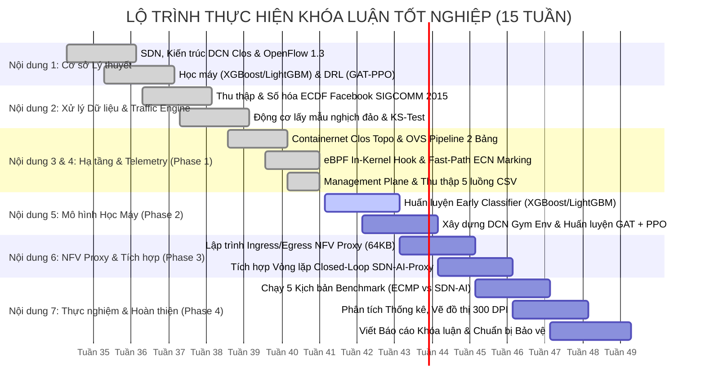

# KẾ HOẠCH TỔNG THỂ DỰ ÁN (OVERALL PROJECT MASTER PLAN)

> **ĐỀ TÀI KHÓA LUẬN TỐT NGHIỆP ĐẠI HỌC**  
> **Tên đề tài tiếng Việt:** Nghiên cứu Tối ưu hóa Kỹ thuật Lưu lượng trong Mạng Trung tâm Dữ liệu Dựa trên Mạng Điều khiển bằng Phần mềm và Trí tuệ Nhân tạo  
> **Tên đề tài tiếng Anh:** Research on Traffic Engineering Optimization in Data Center Networks Based on Software-Defined Network and Artificial Intelligence (SDN-AI DCN)  
> **Sinh viên thực hiện:** Lê Phan Tuấn Khôi (MSSV: MMTT2023_2), Ngô Mạnh Kiên (MSSV: MMTT2023_2)  
> **Giảng viên hướng dẫn:** ThS. Nguyễn Khánh Thuật  
> **Cố vấn Kiến trúc Kỹ thuật:** Senior SDN Architect (Gemini 4 Argon)  
> **Phiên bản:** v4.5 (Kiến trúc Phân tầng 2 Miền Thời gian: Fast-Path Data Plane Reflex & Closed-Loop SDN-AI Governance)  
> **Ngày cập nhật:** 2026-10-18  

---

## 1. TỔNG QUAN ĐỀ TÀI & BỐI CẢNH KHOA HỌC

### 1.1. Bối cảnh & Hiện tượng Phân cực Lưu lượng trong Mạng Trung tâm Dữ liệu (DCN)
Trong các mạng Trung tâm Dữ liệu (Data Center Networks - DCN) quy mô lớn hiện đại (Facebook, Google, Microsoft, Meta), lưu lượng mạng mang tính chất lưỡng cực và tuân theo phân phối đuôi nặng (Heavy-tailed Pareto Distribution):
- **Luồng Chuột (Mice Flows):** Chiếm $80\% - 90\%$ tổng số lượng luồng nhưng chỉ đóng góp dưới $10\% - 20\%$ tổng dung lượng byte. Sinh ra từ các bản tin điều khiển phân tán, truy vấn Web RPC, bộ đệm phân tán Memcached/Redis. Nhóm này cực kỳ nhạy cảm với độ trễ (**Latency-sensitive**) và thời gian hoàn thành luồng (**Flow Completion Time - FCT**).
- **Luồng Voi (Elephant Flows):** Chỉ chiếm $10\% - 20\%$ tổng số lượng luồng nhưng vận chuyển trên $80\%$ tổng lượng dữ liệu toàn mạng. Phát sinh từ các tiến trình sao lưu cơ sở dữ liệu, đồng bộ trọng số mô hình AI/LLM, phân tán MapReduce/Hadoop/Spark. Nhóm này đòi hỏi thông lượng cao (**Throughput-sensitive / Goodput**).
- **Xung lưu lượng đột biến (Microbursts / Incast):** Các đợt bùng nổ dữ liệu chớp nhoáng ($20\text{ KB} - 80\text{ KB}$, thời gian sống $\Delta t < 10\text{ ms}$) sinh ra khi hàng chục máy chủ đồng loạt phản hồi truy vấn về một máy chủ đích (TCP Incast).

### 1.2. Thách thức Cốt lõi của Cơ chế Định tuyến ECMP Truyền thống
Equal-Cost Multi-Path (ECMP) là chuẩn công nghiệp mặc định trên các switch DCN phần cứng thương mại. ECMP thực hiện băm tĩnh (Hash-based) 5-tuple (`src_ip, dst_ip, ip_proto, src_port, dst_port`) để phân bổ luồng vào các liên kết song song cùng chi phí:
1. **Xung đột băm mù (Blind Hash Collision):** ECMP không nhận biết được trạng thái tải tức thời của liên kết (Oblivious). Khi hai hoặc nhiều luồng Voi bị băm vào cùng một đường truyền vật lý, liên kết đó lập tức bị bão hòa ($100\%$ Capacity).
2. **Nghẽn hàng đợi & Rớt gói (Queue Overflow & Buffer Drop):** Bộ đệm hàng đợi (Buffer Queue) của switch trên nhánh xung đột bị tràn, kích hoạt cơ chế Drop-tail hoặc trễ xếp hàng nghiêm trọng ($t_{\text{queue}} \gg 10\text{ ms}$).
3. **Phạt nặng luồng Chuột (Mice Flow Starvation):** Hàng ngàn gói tin luồng Chuột đi chung đường truyền bị kẹt sau các gói tin $1500\text{ B}$ của luồng Voi (Head-of-Line Blocking), khiến đuôi độ trễ (Tail Latency $p95, p99$) và FCT của luồng Chuột tăng vọt gấp $10 - 50$ lần, phá vỡ cam kết chất lượng dịch vụ (SLA) của các ứng dụng Microservices.

### 1.3. Giải pháp Đột phá của Đề tài: Mô hình Phân công 2 Miền Thời gian (Dual-Time-Domain Governance)
Đề tài đề xuất kiến trúc điều phối lưu lượng kết hợp hài hòa giữa **Phản xạ nhanh tại Mặt phẳng Dữ liệu (Data Plane Reflex)** và **Vòng lặp Kiểm soát Đóng bằng Trí tuệ Nhân tạo (Closed-Loop SDN-AI)**:

```
+----------------------------------------------------------------------------------------------------+
|                                    KIẾN TRÚC PHÂN CÔNG 2 MIỀN THỜI GIAN                            |
+----------------------------------------------------------------------------------------------------+
|                                                                                                    |
|  [ MIỀN 1: FAST-PATH DATA PLANE REFLEX (Sub-millisecond) ]                                         |
|  - Đối tượng: Luồng Chuột (Miceflows) & Xung đột biến (Microbursts)                               |
|  - Cơ chế chuyển tiếp: Hardware ECMP Group Table (OFPGT_SELECT, Priority 100)                      |
|  - Cơ chế chống nghẽn: ECN Marking (RFC 3168 / RFC 8257 DCTCP) với ngưỡng K = 30 KB (~20 pkts)    |
|  - Tốc độ xử lý: Nano-giây đến Micro-giây tại OVS Datapath, Zero-PacketIn, Zero-Drop               |
|                                                                                                    |
|  [ MIỀN 2: SLOW-PATH SDN-AI CLOSED-LOOP GOVERNANCE (Seconds / Continuous) ]                        |
|  - Đối tượng: Luồng Voi bền vững (Persistent Elephant Flows > 100KB, duration > 100ms)             |
|  - Phát hiện sớm: Mô hình Machine Learning (XGBoost / LightGBM) suy luận dưới 1ms                 |
|  - Bẻ hướng: Ryu Controller cài luật Priority 1000 điều hướng vào cổng "proxy-int"                |
|  - Cắt & Rải đa đường: Ingress NFV Proxy chia khối 64KB rải theo ma trận tỷ lệ GAT-PPO DRL        |
|  - Tái sắp xếp: Egress NFV Proxy đệm và sắp xếp lại đúng TCP Seq Num (Out-of-Order = 0%)           |
|                                                                                                    |
+----------------------------------------------------------------------------------------------------+
```

---

## 2. KIẾN TRÚC TỔNG THỂ 4 TẦNG (FOUR-TIER ARCHITECTURE)

Hệ thống được thiết kế theo cấu trúc module hóa phân tầng nghiêm ngặt:



---

## 3. DANH MỤC 8 HẠNG MỤC KẾ HOẠCH CHI TIẾT (WORK PACKAGES - WP)

Hệ thống kế hoạch cập nhật được phân chia thành 8 chuyên đề kỹ thuật chuyên sâu nằm trong thư mục [`.Project Plans/Updated_Plan/`](file:///c:/Users/USER/Desktop/SDN%20KLTN/.Project%20Plans/Updated_Plan/):

| STT | Mã Kế Hoạch | Tên Chuyên Đề Kế Hoạch Chi Tiết | Trọng Tâm Công Nghệ & Cơ Sở Khoa Học | Trạng Thái |
| :---: | :--- | :--- | :--- | :---: |
| 1 | [`01_DATA_PLANE`](file:///c:/Users/USER/Desktop/SDN%20KLTN/.Project%20Plans/Updated_Plan/01_DATA_PLANE_TOPOLOGY_INFRASTRUCTURE_PLAN.md) | **Hạ tầng Mạng 2-Cluster Clos & Phản xạ Data Plane ECN** | Clos Spine-Leaf, OVS Datapath, Ma trận đồng dạng 4 miền ($\alpha, \beta, \tau$), RED/ECN queue threshold $K=30\text{ KB}$, Mô hình hàng đợi $M/M/1/K$. | **Đã hoàn thành 100%** |
| 2 | [`02_SDN_CONTROL`](file:///c:/Users/USER/Desktop/SDN%20KLTN/.Project%20Plans/Updated_Plan/02_SDN_CONTROL_PLANE_OPENFLOW_PIPELINE_PLAN.md) | **Mặt phẳng Điều khiển Ryu & OpenFlow 1.3 Multi-Table** | Pipeline 2 bảng OpenFlow 1.3, Table 0 Bi-flow Priority 150, ECN CE Counter Priority 60, Table 1 ECMP Priority 100, LLDP Debounce, Proxy ARP. | **Đã hoàn thành 100%** |
| 3 | [`03_TRAFFIC_ENGINE`](file:///c:/Users/USER/Desktop/SDN%20KLTN/.Project%20Plans/Updated_Plan/03_UNIFIED_TRAFFIC_SIMULATION_ENGINE_PLAN.md) | **Động cơ Sinh tải Thống nhất Facebook DCN (SIGCOMM 2015)** | Hòa trộn ECDF lồi, Lấy mẫu biến đổi ngược $\log_{10}$, Piecewise Scaling, 4 cấp Locality, Dual Protocol (18.4% UDP, 81.6% TCP), Kiểm định KS-Test. | **Đã hoàn thành 100%** |
| 4 | [`04_DEEP_TELEMETRY`](file:///c:/Users/USER/Desktop/SDN%20KLTN/.Project%20Plans/Updated_Plan/04_DEEP_TELEMETRY_EBPF_MANAGEMENT_PLANE_PLAN.md) | **Giám sát Vi mô Toàn diện & In-Kernel eBPF Telemetry** | eBPF TC hook nano-giây, Perf Ring Buffer, Docker Stats đa luồng không timeout, Lần vết Hop-by-Hop đường đi, 5 tệp CSV dữ liệu thời gian thực. | **Đã hoàn thành 100%** |
| 5 | [`05_AI_CLASSIFIER`](file:///c:/Users/USER/Desktop/SDN%20KLTN/.Project%20Plans/Updated_Plan/05_AI_EARLY_FLOW_CLASSIFIER_PLAN.md) | **Tầng Học Máy: Phân loại Luồng Voi/Chuột Sớm Dưới 1ms** | XGBoost / LightGBM, Bộ 10 Features Bi-flow, Ngưỡng Ground-truth Pareto P90/P95, Ngân sách trễ $<1\text{ ms}$, $\text{F1-Score} > 92\%$, $\text{Recall} > 95\%$. | **Sẵn sàng triển khai** |
| 6 | [`06_INTELLIGENT_ROUTING`](file:///c:/Users/USER/Desktop/SDN%20KLTN/.Project%20Plans/Updated_Plan/06_INTELLIGENT_ROUTING_GAT_PPO_DRL_PLAN.md) | **Định tuyến Đa đường Thông minh (GAT + PPO DRL)** | Graph Attention Network nhúng topo, DRL PPO tối ưu tỷ lệ chia tải, Môi trường Gymnasium DCN, Hàm phần thưởng Bisection BW & Link Fairness. | **Sẵn sàng triển khai** |
| 7 | [`07_NFV_PROXY`](file:///c:/Users/USER/Desktop/SDN%20KLTN/.Project%20Plans/Updated_Plan/07_IN_NETWORK_NFV_PROXY_PACKET_REASSEMBLY_PLAN.md) | **Ứng dụng Nhúng NFV Proxy: Phân mảnh & Tái hợp TCP** | Access switch proxy-int, Flowcell Slicing 64KB theo tỷ lệ PPO, Egress Buffer tái tổ hợp theo TCP Seq Num, Triệt tiêu rủi ro Out-of-Order ($0\%$). | **Thiết kế chi tiết** |
| 8 | [`08_BENCHMARK_EVAL`](file:///c:/Users/USER/Desktop/SDN%20KLTN/.Project%20Plans/Updated_Plan/08_PERFORMANCE_EVALUATION_ACADEMIC_BENCHMARK_PLAN.md) | **Thực nghiệm Đối sánh Học thuật & Tiêu chí Đánh giá** | True FCT, Tail Latency ($p95, p99$), Goodput, Bisection Bandwidth, Jain's Index, 5 kịch bản khắc nghiệt (Saturation, Failure Fail-open, Incast, Data Shift). | **Thiết kế chi tiết** |

---

## 4. MA TRẬN LIÊN THÔNG VÀ ÁNH XẠ MÃ NGUỒN (SOURCE CODE TRACEABILITY)

Tất cả các tệp mã nguồn hiện tại và tương lai của đề tài được ánh xạ tường minh với các phân hệ kế hoạch:

```
c:\Users\USER\Desktop\SDN KLTN\
├── .Project Plans/Updated_Plan/                 [HỆ THỐNG KẾ HOẠCH CẬP NHẬT CHUẨN XUẤT SẮC]
│   ├── 00_PROJECT_OVERALL_MASTER_PLAN.md       <── Kế hoạch Tổng thể (Tệp này)
│   ├── 01_DATA_PLANE_TOPOLOGY_INFRASTRUCTURE_PLAN.md
│   ├── 02_SDN_CONTROL_PLANE_OPENFLOW_PIPELINE_PLAN.md
│   ├── 03_UNIFIED_TRAFFIC_SIMULATION_ENGINE_PLAN.md
│   ├── 04_DEEP_TELEMETRY_EBPF_MANAGEMENT_PLANE_PLAN.md
│   ├── 05_AI_EARLY_FLOW_CLASSIFIER_PLAN.md
│   ├── 06_INTELLIGENT_ROUTING_GAT_PPO_DRL_PLAN.md
│   ├── 07_IN_NETWORK_NFV_PROXY_PACKET_REASSEMBLY_PLAN.md
│   └── 08_PERFORMANCE_EVALUATION_ACADEMIC_BENCHMARK_PLAN.md
│
├── controller/                                 [MẶT PHẲNG ĐIỀU KHIỂN & TELEMETRY ĐÃ HOÀN THIỆN]
│   ├── controller.py                           <── WP2 (Ryu OpenFlow 1.3 Multi-Table Pipeline)
│   ├── spine_leaf_topo.py                      <── WP1 (Containernet Clos Topo & RED/ECN qdisc)
│   ├── management_plane.py                     <── WP4 (Comprehensive Telemetry Engine)
│   ├── traffic_generator.py                    <── WP3 (Facebook Synthetic Traffic Generator)
│   ├── unified_sampler.py                      <── WP3 (Mathematical Inverse ECDF Sampler)
│   ├── microburst_generator.py                 <── WP1 & WP3 (Heavy Jitter / Ephemeral Microburst)
│   ├── dcn_flow_engine.py                      <── WP3 (High-performance TCP/UDP Flow Socket)
│   ├── ebpf_telemetry.c                        <── WP4 (Kernel-space eBPF / TC Network Hook)
│   ├── ebpf_loader.py                          <── WP4 (BCC eBPF Userspace Loader)
│   ├── topology_config.json                    <── WP1 (Master IaC Infrastructure Schema)
│   ├── traffic_config.json                     <── WP1 & WP3 (Traffic Matrix & ECN Settings)
│   └── supply/                                 <── WP3 (Các script phân tích thống kê ECDF & KS-Test)
│
├── ml_engine/                                  [TẦNG HỌC MÁY & DRL ROUTING - SẴN SÀNG TRIỂN KHAI]
│   ├── classifier/                             <── WP5 (Huấn luyện & Suy luận XGBoost / LightGBM)
│   └── routing/                                <── WP6 (Mạng nơ-ron GAT + PPO Gymnasium Environment)
│
├── nfv_proxy/                                  [ỨNG DỤNG NHÚNG NFV PROXY TẠI SWITCH ACCESS]
│   └── proxy_daemon.py                         <── WP7 (Flowcell Slicing 64KB & TCP Reassembly)
│
├── evaluate/                                   [KỊCH BẢN THỰC NGHIỆM ĐỐI SÁNH BENCHMARK]
│   └── benchmark_scenarios.py                  <── WP8 (Chạy tự động 5 Kịch bản & Xuất Biểu đồ 300 DPI)
│
└── results/                                    [KHO DỮ LIỆU THỰC NGHIỆM & KẾT QUẢ ĐO LƯỜNG]
    ├── traffic_flow_dataset_with_paths.csv     <── Bộ dữ liệu 10 features luồng phục vụ AI
    ├── link_utilization_telemetry.csv          <── Telemetry băng thông từng liên kết thời gian thực
    ├── device_resource_utilization.csv         <── Telemetry CPU/RAM/IO của Host và Switch OVS
    ├── system_and_network_health.csv           <── Giám sát trạng thái TCAM và sức khỏe switch
    └── network_evaluation_kpis.csv             <── Báo cáo các chỉ số học thuật (FCT, Loss, Goodput)
```

---

## 5. LỘ TRÌNH 15 TUẦN THEO ĐỀ CƯƠNG KLTN CHÍNH THỨC

Tiến độ thực hiện bám sát kế hoạch 15 tuần đã được phê duyệt trong Đề cương Khóa luận Tốt nghiệp:



---

## 6. DANH MỤC CÔNG CỤ, MÔI TRƯỜNG & TÀI LIỆU THAM KHẢO CHÍNH

### 6.1. Ngăn xếp Công nghệ & Công cụ Kỹ thuật (Technology Stack)
- **Hệ điều hành Host & VM:** Ubuntu Server 22.04 LTS (Kernel Linux 5.15+ / 6.x hỗ trợ BPF/XDP).
- **Mặt phẳng Dữ liệu ảo hóa:** Containernet (Mininet 2.3.1+ tích hợp Docker SDK), Open vSwitch 2.17+ hỗ trợ OpenFlow 1.3 & Group Table type `SELECT`.
- **Mặt phẳng Điều khiển:** Ryu SDN Framework 4.34 (Python 3.10+, Event Loop Hub, REST API).
- **Hạ tầng Telemetry Hạt nhân:** BCC (BPF Compiler Collection), LLVM/Clang Compiler, Linux TC (Traffic Control) subsystem.
- **Tầng Học máy & DRL:** PyTorch 2.x, PyTorch Geometric (PyG - hỗ trợ GATConv), Stable-Baselines3 / CleanRL (thuật toán PPO), Gymnasium (chuẩn môi trường RL), XGBoost, LightGBM, Scikit-learn.
- **Thư viện Toán học & Trực quan hóa:** NumPy, SciPy (phân phối xác suất, kiểm định KS-Test `ks_2samp`), Pandas, NetworkX, Matplotlib, Seaborn.

### 6.2. Tài liệu Tham khảo Khoa học Cốt lõi (Core References)
1. **[Facebook SIGCOMM 2015]** A. Roy, et al., *"Inside the Social Network's (Datacenter) Network"*, ACM SIGCOMM 2015. *(Cơ sở thực nghiệm phân phối lưu lượng Web, Cache, Hadoop).*
2. **[Presto SIGCOMM 2015]** K. He, et al., *"Presto: Edge-based Load Balancing for Fast Datacenter Networks"*, ACM SIGCOMM 2015. *(Cơ sở chia nhỏ Flowcell 64KB & khử out-of-order).*
3. **[Hedera NSDI 2010]** M. Al-Fares, et al., *"Hedera: Dynamic Flow Scheduling for Data Center Networks"*, USENIX NSDI 2010. *(Cơ sở phân tách ngưỡng Elephant Flow).*
4. **[CONGA SIGCOMM 2014]** M. Alizadeh, et al., *"CONGA: Distributed Congestion-Aware Load Balancing for Datacenters"*, ACM SIGCOMM 2014. *(Cơ sở đo lường trạng thái hàng đợi và chuyển mạch thích ứng).*
5. **[WCMP EuroSys 2014]** J. Zhou, et al., *"WCMP: Weighted Cost Multipathing for Improved Fairness in Data Centers"*, ACM EuroSys 2014. *(Cơ sở băm đa đường có trọng số).*
6. **[DCTCP SIGCOMM 2010]** M. Alizadeh, et al., *"Data Center TCP (DCTCP)"*, ACM SIGCOMM 2010 (RFC 8257). *(Cơ sở ECN Marking tại ngưỡng hàng đợi siêu nhỏ $K$).*
7. **[GAT ICLR 2018]** P. Veličković, et al., *"Graph Attention Networks"*, ICLR 2018. *(Cơ sở nhúng topo mạng bằng cơ chế Attention).*
8. **[PPO 2017]** J. Schulman, et al., *"Proximal Policy Optimization Algorithms"*, arXiv:1707.06347, 2017. *(Cơ sở thuật toán DRL huấn luyện chính sách phân tải).*
