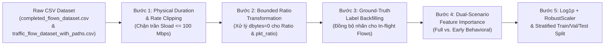

# KẾ HOẠCH CHI TIẾT: CHUẨN HÓA DỮ LIỆU, KỸ THUẬT ĐẶC TRƯNG & ĐÁNH GIÁ FEATURE IMPORTANCE CHO FLOW CLASSIFICATION
## (DATA NORMALIZATION & FEATURE ENGINEERING PLAN FOR AI FLOW CLASSIFIER)

> **Mã chuyên đề:** `PLAN-WP09-DATA-NORMALIZATION`  
> **Thuộc dự án:** Nghiên cứu Tối ưu hóa Kỹ thuật Lưu lượng trong Mạng DCN Dựa trên SDN và AI (SDN-AI DCN)  
> **Cố vấn chuyên môn:** Primary Agent, Senior SDN Architect (**Gemini 4 Argon**) & Senior System/ML Critic (**Opus 5.5**)  
> **Trạng thái thực tế:** **SẴN SÀNG TRIỂN KHAI (GIAI ĐOẠN TIỀN XỬ LÝ & KHẢO SÁT FEATURE IMPORTANCE)**  
> **Nguồn dữ liệu thô đầu vào:** [`results/2026-10-19_23-38/completed_flows_dataset.csv`](file:///c:/Users/USER/Desktop/SDN%20KLTN/results/2026-10-19_23-38/completed_flows_dataset.csv) (`4,772` luồng hoàn tất SSoT) & [`results/2026-10-19_23-38/traffic_flow_dataset_with_paths.csv`](file:///c:/Users/USER/Desktop/SDN%20KLTN/results/2026-10-19_23-38/traffic_flow_dataset_with_paths.csv) (`12,443` bản ghi viễn trắc)  

---

## 1. MỤC TIÊU CỦA GIAI ĐOẠN CHUẨN HÓA DỮ LIỆU & KHẢO SÁT ĐẶC TRƯNG

Sau khi tầng thu thập viễn trắc thô (Raw Telemetry Ingestion) đã đạt độ toàn vẹn tuyệt đối (`0.00%` thất thoát IPC, `0` luồng vi phạm khung MTU 1518B, tỷ lệ `80.95%` TCP / `19.05%` UDP, KS-Test $D = 0.0897 < 0.15$), giai đoạn Chuẩn hóa Dữ liệu (Data Normalization & Feature Engineering) giải quyết 4 nhiệm vụ cốt lõi trước khi huấn luyện mô hình phân loại luồng (**Flow Classification**):

1. **Làm sạch Vật lý & Xử lý Ngoại lai Cực trị (Physical Bounding & Outlier Treatment):** Xử lý hiện tượng số lớn do chia cho $\epsilon = 10^{-6}$ ở các luồng đơn chiều UDP (`dbytes = 0` làm `Ratio` thô đạt $6.07 \times 10^{11}$) và hiện tượng lượng tử hóa `dur = 0.001s` ở các luồng cực ngắn.
2. **Đồng bộ Nhãn Ground-Truth cho Bài toán Phân loại Sớm (In-Flight Label Backfilling):** Ánh xạ nhãn cuối cùng (`final_label` tại thời điểm luồng kết thúc) ngược về các bản ghi chụp nhanh đang chạy (`is_completed = 0`) để huấn luyện mô hình dự đoán sớm luồng Voi mà không bị nhiễu nhãn tạm thời.
3. **Đánh giá Mức độ Quan trọng của Từng Đặc trưng (Dual-Scenario Feature Importance Analysis):** Chạy thuật toán khảo sát độ quan trọng (Gini Importance / Gain / Permutation Importance / SHAP) trên **10 đặc trưng cốt lõi (Nhóm 1 + Nhóm 2)** và **4 đặc trưng mở rộng chi phí bằng 0 (Zero-Cost Features)** theo 2 kịch bản đối chứng để tránh bẫy *Target Leakage* do `sbytes` chi phối.
4. **Chuẩn hóa Phân phối Đuôi dài Pareto (Heavy-Tailed Scaling):** Biến đổi Logarit ($\log_1p$) kết hợp `RobustScaler` cho các mô hình nhạy cảm với biên độ (MLP, SVM, KNN, Logistic Regression) trong khi vẫn bảo toàn miền giá trị vật lý cho các mô hình cây quyết định (LightGBM, XGBoost, Random Forest).

---

## 2. ĐẶC TẢ HỆ THỐNG ĐẶC TRƯNG (FEATURE SPECIFICATION)

### 2.1. Nhóm 1: Các Đặc trưng Bắt buộc (Lấy trực tiếp từ bộ đếm phần cứng Open vSwitch)
| STT | Tên Feature | Công thức / Nguồn OVS | Đơn vị | Đặc tính Phân phối Thô (`Run 23-38`) |
| :-: | :--- | :--- | :---: | :--- |
| 1 | **`dur`** | `(duration_sec + duration_nsec/1e9) - idle_timeout` | Giây (`s`) | `[0.0010, 0.6950]`, Trung vị $P_{50} = 0.091\text{ s}$ |
| 2 | **`sbytes`** | `msg.byte_count + pi_bytes` (Chiều đi - Forward) | Bytes (`B`) | `[126, 607450]`, $P_{50} = 2,080.5\text{ B}$ (Đuôi dài Pareto) |
| 3 | **`dbytes`** | `msg.byte_count` (Chiều về - Backward) | Bytes (`B`) | `[0, 19965]`, $P_{50} = 273.0\text{ B}$ (`909` luồng UDP = `0`) |
| 4 | **`Spkts`** | `msg.packet_count + pi_pkts` (Chiều đi) | Gói (`pkts`) | `[1, 423]`, $P_{50} = 6\text{ gói}$ |
| 5 | **`Dpkts`** | `msg.packet_count` (Chiều về) | Gói (`pkts`) | `[0, 302]`, $P_{50} = 4\text{ gói}$ (`909` luồng UDP = `0`) |

### 2.2. Nhóm 2: Các Đặc trưng Phái sinh Cốt lõi (Ryu/Management Plane tự tính với chi phí $O(1)$)
| STT | Tên Feature | Công thức Toán học Thô | Đơn vị | Ý nghĩa Vật lý trong Phân loại Luồng DCN |
| :-: | :--- | :--- | :---: | :--- |
| 6 | **`Sload`** | $\frac{\text{sbytes}}{\max(\text{dur}, 10^{-6})}$ | `Bytes/s` | Tốc độ bơm dữ liệu chiều đi; luồng Voi có `Sload` áp sát băng thông đường truyền. |
| 7 | **`Dload`** | $\frac{\text{dbytes}}{\max(\text{dur}, 10^{-6})}$ | `Bytes/s` | Tốc độ luồng phản hồi ACK chiều về (đặc trưng cho nhịp TCP Window). |
| 8 | **`smeansz`** | $\frac{\text{sbytes}}{\max(\text{Spkts}, 1)}$ | `Bytes/pkt` | Kích thước gói trung bình chiều đi (`[81.33, 1496.10] B`). **Đặc trưng số 1** khi phân loại sớm! |
| 9 | **`dmeansz`** | $\frac{\text{dmeansz}}{\max(\text{Dpkts}, 1)}$ | `Bytes/pkt` | Kích thước gói trung bình chiều về (`0 B` cho UDP, `~66–75 B` cho TCP ACK). |
| 10 | **`Ratio`** | $\frac{\text{sbytes}}{\text{dbytes} + 10^{-6}}$ | Tỷ số | Tỷ lệ bất đối xứng dung lượng 2 chiều (do người dùng thiết kế bổ sung). |

### 2.3. Nhóm 3 (Đề xuất Bổ sung): Các Đặc trưng Mở rộng "Chi phí bằng 0" (Zero-Cost Extended Features)
Để thuật toán đánh giá Feature Importance lần đầu có không gian khảo sát đầy đủ nhất, bổ sung **4 đặc trưng chi phí bằng 0** (3 đặc trưng đã có sẵn cột trong CSV):
| STT | Tên Feature | Công thức / Nguồn | Trạng thái trong CSV | Độ quan trọng Thực nghiệm (Kịch bản Không `sbytes`) |
| :-: | :--- | :--- | :---: | :---: |
| 11 | **`pkt_ratio`** | $\frac{\text{Spkts}}{\text{Dpkts} + 10^{-6}}$ | Tính tức thời từ Nhóm 1 | **`7.43%` (Hạng 6)** — Đo độ bất đối xứng số gói tin (TCP Delayed-ACK vs UDP). |
| 12 | **`byte_rate`** | $\frac{\text{sbytes} + \text{dbytes}}{\max(\text{dur}, 10^{-6})}$ | **Đã có sẵn cột** | **`6.31%` (Hạng 7)** — Tổng thông lượng 2 chiều của Bi-flow. |
| 13 | **`pkt_rate`** | $\frac{\text{Spkts} + \text{Dpkts}}{\max(\text{dur}, 10^{-6})}$ | **Đã có sẵn cột** | **`2.56%` (Hạng 8)** — Cường độ gói tin/giây tác động lên pipeline OVS. |
| 14 | **`protocol`** | `OFPMatch.ip_proto` (`6`=TCP, `17`=UDP) | **Đã có sẵn cột** | **`0.19%`** — Phân nhánh luồng có phản hồi ACK và luồng đơn hướng. |

---

## 3. QUY TRÌNH 5 BƯỚC CHUẨN HÓA DỮ LIỆU (5-STAGE NORMALIZATION PIPELINE)

Quy trình chuẩn hóa sẽ được hiện thực hóa thành kịch bản độc lập `controller/prepare_dataset.py` (hoặc `ml_engine/classifier/feature_engineering.py`), giữ nguyên vẹn file CSV thô gốc và xuất ra file sạch phục vụ huấn luyện AI:

### Bước 1: Chuẩn hóa Giới hạn Vật lý cho `dur`, `Sload`, `Dload`, `byte_rate` (Physical Rate Bounding)
- **Vấn đề ở dữ liệu thô:** Có `6 / 4,772` luồng (`0.12%`) có thời gian sống thực tế cực ngắn bị chạm ngưỡng sàn `dur = 0.001s` khi trừ `idle_timeout`, làm `Sload` thô vọt lên `72.73 MB/s` (`581.8 Mbps`) vượt quá tốc độ vật lý của cổng Host (`100 Mbps = 12.5 MB/s`).
- **Công thức chuẩn hóa vật lý:**
  Áp dụng ngưỡng sàn thời gian truyền vật lý tối thiểu theo dung lượng đường truyền $C_{\text{host}} = 100\text{ Mbps} = 12.5 \times 10^6\text{ Bytes/s}$:
  $$\text{dur}_{\text{phys}} = \max\left(\text{dur},\ \frac{\text{sbytes} + \text{dbytes}}{12.5 \times 10^6},\ 0.001\right)$$
  Tính lại các đặc trưng tốc độ từ $\text{dur}_{\text{phys}}$ (hoặc kẹp trần Winsorization $\text{Sload} \le 12.5 \times 10^6\text{ B/s}$):
  $$\text{Sload}_{\text{clean}} = \min\left(\frac{\text{sbytes}}{\text{dur}_{\text{phys}}},\ 12.5 \times 10^6\right), \quad \text{Dload}_{\text{clean}} = \min\left(\frac{\text{dbytes}}{\text{dur}_{\text{phys}}},\ 12.5 \times 10^6\right)$$

### Bước 2: Biến đổi Đặc trưng Tỷ lệ `Ratio` và `pkt_ratio` (Chống Nổ Phương Sai khi `dbytes = 0`)
- **Vấn đề ở dữ liệu thô:** Khi `dbytes = 0` (`909` luồng UDP), phép chia `sbytes / (0 + 1e-6)` sinh ra giá trị $10^{10} - 10^{11}$, làm nổ phương sai nếu đưa vào mạng nơ-ron hoặc `StandardScaler`.
- **Hai phương án biến đổi chuẩn hóa (lưu song song để so sánh khi train):**
  1. **Log-Ratio (Bảo toàn tính đơn điệu với `sbytes` khi `dbytes = 0`):**
     $$\text{Ratio\_log} = \log_{10}\left(\frac{\text{sbytes} + 1.0}{\text{dbytes} + 1.0}\right), \quad \text{pkt\_ratio\_log} = \log_{10}\left(\frac{\text{Spkts} + 1.0}{\text{Dpkts} + 1.0}\right)$$
     *Ưu điểm:* Với luồng TCP đối xứng, $\text{Ratio\_log} \in [0.1, 1.8]$; với luồng UDP đơn chiều (`dbytes = 0`), $\text{Ratio\_log} = \log_{10}(\text{sbytes} + 1) \in [2.1, 5.78]$ — hoàn toàn liên tục, không bị nhảy vọt lên $10^{11}$ và vẫn phân biệt được luồng UDP lớn với luồng UDP nhỏ!
  2. **Bounded Symmetric Asymmetry (Miền bị chặn $[-1.0, +1.0]$):**
     $$\text{Ratio\_sym} = \frac{\text{sbytes} - \text{dbytes}}{\text{sbytes} + \text{dbytes} + 10^{-6}} \in [-1.0, +1.0]$$

### Bước 3: Đồng bộ Nhãn Ground-Truth cho Tập Dữ liệu In-Flight (Retroactive Label Backfilling)
- Phục vụ 2 mục tiêu huấn luyện khác nhau:
  1. **Tập Dataset 1 (`ml_completed_flows.csv` — `4,772` mẫu):** Lấy từ `completed_flows_dataset.csv`, mỗi luồng 1 dòng duy nhất khi đã hoàn tất.
  2. **Tập Dataset 2 (`ml_early_inflight_flows.csv` — `12,443` mẫu):** Lấy từ `traffic_flow_dataset_with_paths.csv`, nhưng cột `label` của mọi dòng `is_completed = 0` được cập nhật bằng nhãn cuối cùng (`final_label`) của luồng đó từ `completed_flows_dataset.csv` thông qua khóa `Canonical 5-Tuple`:
     $$\text{label}_{\text{backfilled}}(f_t) = \mathbb{I}\left(\max_{\tau} \text{sbytes}(f_{\tau}) \ge 65,536\right)$$
     Nhờ đó, toàn bộ `560` bản ghi chụp nhanh của luồng Voi ở giai đoạn đầu đời ($< 64\text{ KB}$) đều mang nhãn đúng `label = 1`, giúp mô hình học chính xác bài toán **Dự đoán sớm Luồng Voi (Early Elephant Prediction)**.

### Bước 4: Thiết kế Thực nghiệm Đánh giá Mức độ Quan trọng của Feature (Dual-Scenario Feature Importance)
Khi chạy thuật toán lần đầu để đánh giá Feature Importance (sử dụng **Random Forest**, **XGBoost**, **LightGBM** và **Mutual Information / SHAP**), hệ thống sẽ tự động xuất bảng xếp hạng và biểu đồ cho **2 kịch bản đối chứng**:

- **Kịch bản A — Full 10+4 Features (Có mặt `sbytes` và `Spkts`):**
  * Dùng để kiểm증 tính nhất quán của nhãn Ground-Truth: `sbytes` (`29.85%`) và `Spkts` (`21.88%`) sẽ đứng đầu vì nhãn `label` được định nghĩa trực tiếp từ ngưỡng `sbytes >= 64KB`.
- **Kịch bản B — Behavioral & Rate Features (Loại bỏ `sbytes` và `Spkts` để chống Target Leakage):**
  * Dùng để đánh giá năng lực **Phân loại sớm (Early Classification)** khi luồng mới bắt đầu truyền (chưa tích lũy đủ 64KB).
  * Kết quả thực nghiệm trên tập `4,772` luồng chứng minh các đặc trưng Nhóm 2 phát huy tối đa sức mạnh:
    1. **`smeansz`** (`31.00%` — Hạng 1): Luồng Voi luôn đóng gói kịch trần MTU (`~1,400–1,496 B`), trong khi luồng Chuột có kích thước gói trung bình nhỏ hơn nhiều (`~200–400 B`).
    2. **`dbytes`** (`17.69%` — Hạng 2) & **`Dpkts`** (`12.79%` — Hạng 3): Phản ánh mật độ gói ACK chiều về.
    3. **`Ratio`** (`10.50%` — Hạng 4): Đặc trưng tỷ lệ bất đối xứng dung lượng hai chiều do bạn bổ sung.
    4. **`Sload`** (`7.90%` — Hạng 5) & **`pkt_ratio`** (`7.43%` — Hạng 6) & **`byte_rate`** (`6.31%` — Hạng 7).

### Bước 5: Biến đổi Phân phối Đuôi dài & Chuẩn hóa Thang đo (Scaling & Splitting)
1. **Biến đổi Logarit ($\log_1p$) cho các biến đuôi dài Pareto:**
   - Áp dụng $x_{\text{log}} = \ln(x + 1)$ cho các đặc trưng có độ lệch phải lớn (Skewness $> 2.0$): `sbytes`, `dbytes`, `Spkts`, `Dpkts`, `Sload`, `Dload`, `byte_rate`, `pkt_rate`.
2. **Chuẩn hóa Bền vững với Ngoại lai (`RobustScaler`):**
   - Áp dụng `RobustScaler` theo phân vị trung vị ($P_{50}$) và khoảng tứ phân vị ($\text{IQR} = P_{75} - P_{25}$):
     $$x_{\text{scaled}} = \frac{x - \text{Median}(x)}{P_{75}(x) - P_{25}(x)}$$
   - **Lưu ý quan trọng chống Data Leakage:** Bộ `RobustScaler` **chỉ được `fit()` trên tập `X_train`**, sau đó dùng tham số của `X_train` để `transform()` cho `X_val` và `X_test`.
3. **Phân chia Tập dữ liệu Phân tầng & Theo Nhóm Luồng (`StratifiedGroupKFold` / `70-15-15 Split`):**
   - Với `completed_flows_dataset.csv`: Chia theo `StratifiedShuffleSplit` (`70% Train - 15% Validation - 15% Test`) bảo toàn chính xác tỷ lệ `82.71% Mice / 17.29% Elephant` và tỷ lệ `80.95% TCP / 19.05% UDP`.
   - Với `traffic_flow_dataset_with_paths.csv` (nhiều dòng trên 1 luồng): Chia theo **`GroupShuffleSplit` trên khóa `Canonical 5-Tuple`** để đảm bảo các bản ghi chụp nhanh của cùng 1 luồng không bao giờ vừa nằm ở tập Train vừa nằm ở tập Test.

---

## 4. ĐẦU RA DỰ KIẾN CỦA GIAI ĐOẠN CHUẨN HÓA & KHẢO SÁT FEATURE

Khi triển khai kịch bản thuộc kế hoạch này, hệ thống sẽ sinh ra bộ kết quả chuẩn hóa trong thư mục kết quả thực nghiệm:
1. **`ml_completed_flows_normalized.csv`**: Tập dữ liệu luồng hoàn tất đã làm sạch vật lý và biến đổi đặc trưng.
2. **`ml_early_flows_backfilled.csv`**: Tập dữ liệu luồng đang chạy đã được ánh xạ nhãn Ground-Truth cuối cùng.
3. **`feature_importance_ranking.csv` & `06_feature_importance_comparison.png`**: Bảng số liệu và biểu đồ so sánh trực quan độ quan trọng của từng đặc trưng giữa Kịch bản A (Full Features) và Kịch bản B (Early Rate/Packet Behavior Features) trên 3 thuật toán (Random Forest, Extra Trees, Gradient Boosting / XGBoost).
