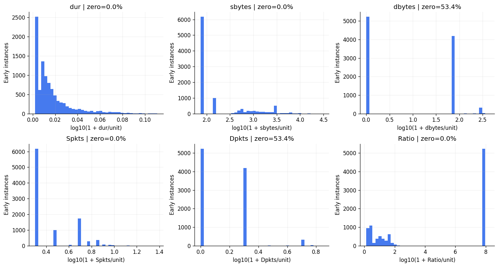
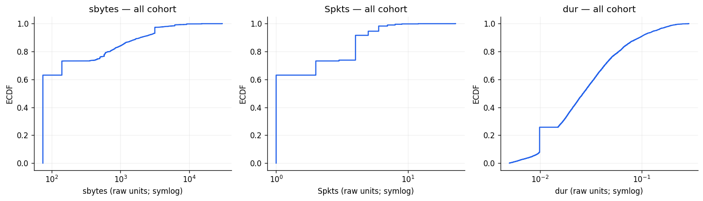
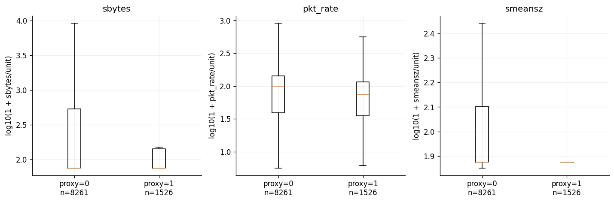
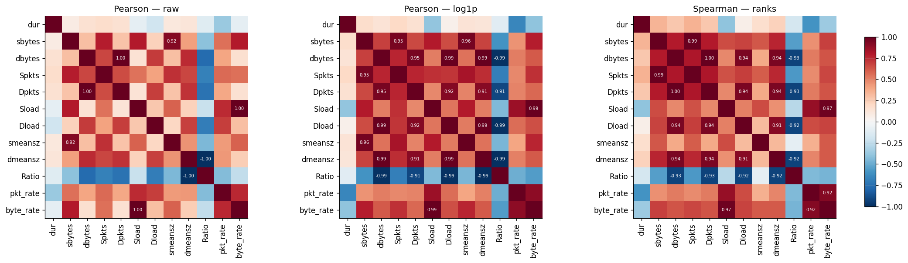
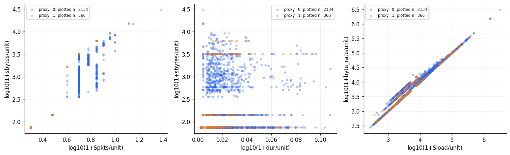
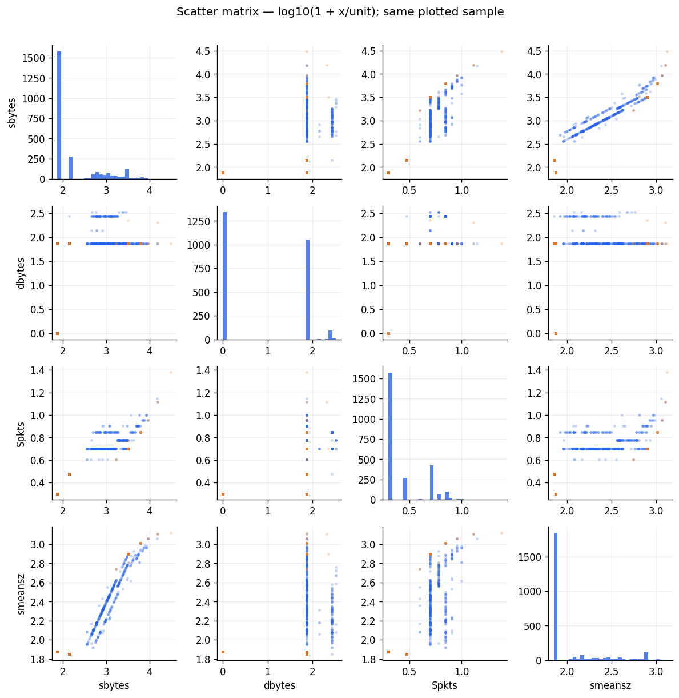
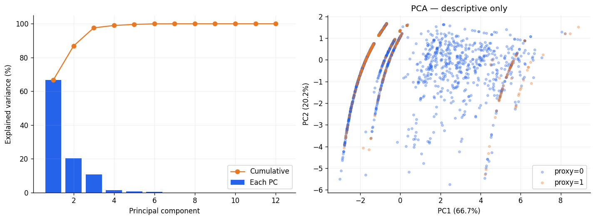
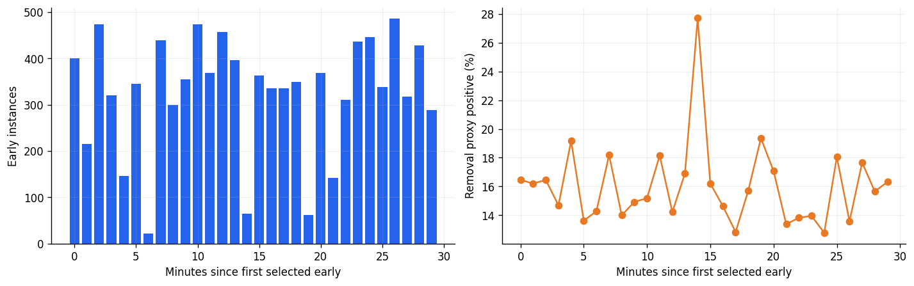

# Giải thích kết quả EDA và hướng xử lý

Ngày đọc: **22/10/2026**. Phạm vi: toàn bộ **39 tệp trong `EDA/`: 30 CSV, 8 PNG, 1 JSON**. Không thay đổi các tệp upload, CSV gốc, notebook, pipeline hoặc nhãn; không huấn luyện mô hình.

Đối chiếu checkout `main@74fa988`, [notebook](../../notebooks/DATASET_STATISTICAL_ANALYSIS.ipynb), [mã tạo notebook](../../notebooks/build_dataset_statistical_analysis.py) và CSV gốc. **Commit checkout không phải commit producer CSV đã xác nhận.** Môi trường ghi trong manifest upload khác môi trường kiểm chứng local trước đây; không suy nền tảng chạy chỉ từ tên tệp.

## Kết luận cần dùng khi viết báo cáo

- Các bảng upload nhất quán với raw: **38.897 bản ghi, 15.670 instance, 9.787 mẫu trong cohort chính, 1.526 proxy dương**. Đã tính lại các thống kê/correlation/effect/PCA quan trọng từ raw; xem [biên bản kiểm chứng](EDA_RESULTS_VERIFICATION.json).
- Dataset không thiếu giá trị theo các kiểm tra định dạng đã xuất. Điều này chưa xác nhận thời gian đo, packet accounting hoặc completion đúng với ứng dụng.
- **63,09% mẫu early có đúng một forward packet và 74 forward bytes**; **53,45% chưa có reverse bytes**. Nhiều biến phân khối/ít biến thiên, làm tín hiệu early nghèo hơn thống kê tại removal.
- Cả 12 liên hệ đơn biến với proxy đều yếu trong cohort này: `|Spearman| ≤ 0,0798`, `|rank-biserial| ≤ 0,1094`. Chưa có kết quả model; không thể từ đó kết luận mô hình đa biến chắc chắn thành công hoặc chắc chắn thất bại.
- Tương quan rất cao giữa một số features chủ yếu có thể giải thích bằng công thức chung, reverse zero và packet size gần cố định. Không phải nhiều nguồn đo độc lập xác nhận cùng một hiện tượng.
- **74,26% cohort có `dur > 10 ms` được ghi nhận**. Gate trong code là **duration ≤ 10 ms HOẶC tổng packet ≤ 10**, không phải đồng thời cả hai. Tên nguồn `sub10ms` chưa chứng minh cutoff thật.
- Nhãn gốc toàn bộ là **`-1`**. Nhãn 0/1 trong EDA là **proxy `removal.sbytes ≥ 65.536 B`**, chưa phải ground truth độc lập về hoàn tất ứng dụng. Mức sử dụng: **A** cho mô tả artifact/cohort; **B** cho prototype dự đoán removal policy với split đúng; **C** hiện tại cho verified early steering, FCT ứng dụng và đánh giá routing.

## Các quy ước và cách đọc chung

**Bốn mẫu số khác nhau:**

| Đơn vị | Số lượng | Dùng cho việc gì? |
|---|---:|---|
| Bản ghi raw | 38.897 | Kiểm schema/provenance, nhiều snapshot của cùng instance |
| Flow instance có cặp early/removal | 15.670 | Phân tích theo instance trong artifact |
| Canonical tuple | 15.669 | Có một tuple dùng lại ở hai instance; không thay khóa instance |
| Cohort chính: một early/instance | 9.787 | Thống kê/correlation/PCA/so sánh proxy chính |

Cohort chính: TCP, source/destination đều trong dải `10.0.0.1–10.0.0.32`, nguồn `early_probe_sub10ms`, và `(dur ≤ 0,010 s OR Spkts+Dpkts ≤ 10)`. Nhãn proxy lấy từ removal ghép theo **đúng `flow_instance_id`**, trong cùng artifact. Chưa biết `run_id` thật.

**Các cột lặp trong bảng thống kê:**

| Cột | Ý nghĩa |
|---|---|
| `variable` / `feature` | Tên biến được thống kê; xem đơn vị ở từ điển dữ liệu |
| `n` / `rows` / `pairs` | Số quan sát; phải đọc theo scope của từng file |
| `mean` | Trung bình; có thể chịu ảnh hưởng mạnh của đuôi phân bố |
| `std` | Độ lệch chuẩn mẫu, `ddof=1`; không phải sai số chuẩn hoặc khoảng tin cậy |
| `min`, `max` | Giá trị nhỏ nhất/lớn nhất trong scope |
| `Q1`, `median`, `Q3` | Phân vị 25%, 50%, 75%; `IQR=Q3−Q1` |
| `P90`, `P95`, `P99` | 90%, 95%, 99% quan sát không vượt giá trị tương ứng |
| `zero_pct` | Tỷ lệ giá trị bằng 0; khác missing |
| `IQR_outside_pct` | Tỷ lệ ngoài `[Q1−1,5IQR; Q3+1,5IQR]`; cờ mô tả, không là phán quyết dữ liệu sai |
| `positive`, `proxy1` | Số instance có proxy dương tại removal |
| `positive_pct`, `proxy1_pct` | Tỷ lệ dương **trong chính nhóm của dòng đó**, không phải phần trăm toàn raw |

Phân vị dùng nội suy nên có thể là số lẻ, dù dữ liệu packet/byte gốc là số nguyên. IQR bằng 0 hoặc dữ liệu rời rạc làm cờ IQR khó diễn giải; đặc biệt không áp ý nghĩa outlier liên tục cho mã protocol, port hoặc nhãn.

Biểu đồ histogram/scatter thường dùng `log10(1+x/unit)`; Pearson-log và PCA dùng `ln(1+x/unit)`. `unit=1` theo đơn vị gốc. Đó là các phép biểu diễn để phân tích, không sửa dữ liệu vật lý. Đổi đơn vị trước log có thể đổi phép biến đổi, nên phải giữ định nghĩa nhất quán.

## Giải thích từng tệp

### 01. [manifest.json](../../EDA/manifest.json)

**Nội dung:** hồ sơ cấu hình lần EDA. `input_name`, `input_sha256` xác định raw; `raw_rows=38.897`, `paired_ids=15.670`; `cohort`, `cohort_n=9.787` mô tả tập chọn; `target=forward_65536B_removal_proxy`, `positive=1.526` mô tả policy nhãn. `seed=42` điều khiển lấy mẫu vẽ/bootstrap; `bootstrap_repeats=200`, `bootstrap_cluster=src_host` mô tả resampling; `plotted_sample=2.500` là mẫu scatter, không phải số mẫu tính thống kê.

Phiên bản **được manifest khai báo**: Python 3.13.15, NumPy 2.1.3, SciPy 1.16.3, Matplotlib 3.10.0. `status` ghi rõ chỉ mô tả và chưa xác minh producer/cutoff/completion.

**Ý nghĩa và xử lý:** SHA-256 raw đã được đối chiếu khớp. Dùng hồ sơ này cho phần phương pháp/phụ lục. Manifest gốc chưa chứa hash notebook, hash từng output, commit producer, run/seed thu thập hoặc timezone; nên bổ sung chúng trong lần xuất sau khi có thông tin thật. Hash output hiện tại trong biên bản kiểm chứng chỉ cố định bộ upload tại thời điểm review, không chứng minh nguồn gốc lần chạy ban đầu.

### 02. [data_dictionary.csv](../../EDA/data_dictionary.csv)

**Nội dung:** 29 dòng mô tả 29 cột raw. Các trường `column`, `dtype`, `meaning`, `unit`, `formula_source`, `role`, `observable` lần lượt là tên, kiểu, diễn giải, đơn vị, công thức/nguồn, vai trò và thời điểm quan sát.

| Cột raw | Cách hiểu và cách sử dụng |
|---|---|
| `timestamp` | Thời điểm dạng chữ của record; chưa biết timezone; metadata |
| `timestamp_epoch_ms` | Mốc millisecond do producer ghi; dùng order/trục tương đối, không làm tín hiệu nhãn |
| `flow_instance_id` | Khóa ghép các pha trong artifact; không phải feature |
| `src_ip` | Endpoint source của hướng forward được ghi nhận |
| `dst_ip` | Endpoint destination của hướng forward; là source khi xét chiều ngược |
| `src_port` | Port endpoint source; metadata, có nguy cơ ghi nhớ generator |
| `dst_port` | Port endpoint destination; không tự chứng minh loại ứng dụng |
| `protocol` | Mã giao thức: 6=TCP, 17=UDP; biến phân loại, hằng trong cohort TCP |
| `dur` | Duration theo nguồn đo, đơn vị giây; chưa xác nhận là application FCT |
| `sbytes` | Counter bytes forward; early có thể làm feature, removal tạo proxy |
| `dbytes` | Counter bytes reverse; 0 có thể hợp lệ tại early |
| `Spkts` | Counter packets forward; có thể đã bị hiệu chỉnh trong collector |
| `Dpkts` | Counter packets reverse; chưa được mặc định là số ACK trên dây |
| `Sload` | Rate forward, `sbytes/max(dur,1e−6)`, đơn vị **B/s** |
| `Dload` | Rate reverse, `dbytes/max(dur,1e−6)`, đơn vị **B/s** |
| `smeansz` | `sbytes/max(Spkts,1)`, B/packet |
| `dmeansz` | `dbytes/max(Dpkts,1)`, B/packet |
| `Ratio` | `sbytes/(dbytes+1e−6)`; rất lớn khi reverse bằng 0 |
| `pkt_rate` | `(Spkts+Dpkts)/max(dur,1e−6)`, packet/s |
| `byte_rate` | `(sbytes+dbytes)/max(dur,1e−6)`, B/s |
| `hop_count` | Số hop theo path suy luận; metadata topology |
| `path` | Chuỗi path suy từ rule/group; chưa phải packet trace |
| `src_host` | Tên host source suy từ IP; metadata và bootstrap cluster |
| `dst_host` | Tên host destination suy từ IP; metadata |
| `locality` | Quan hệ topology giữa hai endpoint; phân tầng/cohort |
| `label` | Nhãn gốc; hiện toàn −1 nghĩa là chưa gán, không phải mice |
| `record_source` | Pha/nguồn early, polling hoặc removal; không là feature chính |
| `duration_source` | Provenance duration, cần cho kiểm tra ngữ nghĩa |
| `is_completed` | Cờ completed/removal của collector; không tự xác nhận receiver hoàn tất |

**Lưu ý diễn giải:** chữ “reverse” trong mô tả `dst_ip` ở file không có nghĩa mỗi row là một flow reverse riêng. Câu `observable` lặp về proxy sau removal không có nghĩa mọi metadata đều chỉ xuất hiện sau removal; phải xét từng trường ở từng event. Hướng forward chưa được xác nhận luôn là TCP SYN initiator.

**Xử lý:** tách `X_early`, `y_proxy` và metadata. Không đưa ID/IP/port/path/epoch/nhãn/completion vào bộ feature chính chỉ vì chúng tồn tại. Không đưa removal rates vào X early: `Sload×dur` có thể tái tạo bytes dùng tạo nhãn. `pkt_ratio` trong pipeline F14 chưa có trong raw này; không trình bày nó như phép đo đã xuất ở EDA.

### 03. [raw_quality.csv](../../EDA/raw_quality.csv)

**Nội dung:** 29 dòng, một dòng/cột raw. `missing_blank` đếm chuỗi rỗng; `invalid_numeric` đếm số không parse được hoặc integer có phần lẻ; `nonfinite` đếm NaN/Inf ở cột số; `negative` đếm số âm; `unique` đếm giá trị phân biệt theo biểu diễn gốc.

**Kết quả:** mọi cột có missing/invalid/nonfinite bằng 0. Chỉ `label` có 38.897 giá trị âm, đều là −1 hợp lệ. Có 32 source IP, 33 destination IP, 2 protocol, 5 destination port, 5 record source và 4 locality.

**Ý nghĩa và xử lý:** chưa cần imputer cho artifact này. Không đổi −1 thành 0. “Không thiếu dữ liệu” chỉ nói về trường đã xuất, chưa nói collector không bỏ sót event/flow hoặc đo đúng. Cột text có `nonfinite=0` vì không được kiểm như số, không phải một kiểm định về ý nghĩa text.

### 04. [raw_numeric_profile.csv](../../EDA/raw_numeric_profile.csv)

**Nội dung:** 19 biến số trên **38.897 records**, dùng các cột profile đã giải thích. Phạm vi này trộn early/polling/removal.

**Kết quả:** raw `sbytes` median 1.163 B, mean 14.721,94 B, P99 99.501,28 B, max 626.083 B; `dur` median 76,5 ms, max 1,17 s. Reverse-zero 30,93%. `Ratio` max 540.531.000.000; `Sload` max 134.872.000 B/s, tương đương danh nghĩa khoảng 1.078,98 Mb/s nếu đổi đơn vị.

**Ý nghĩa:** các snapshot không độc lập và instance nhiều polling có trọng số lớn hơn. Giá trị rate rất cao cần đối chiếu duration/counter/source; chưa được gọi là throughput thật. Mean protocol 7,59 không có ý nghĩa “giao thức trung bình”; UDP=17 không là outlier lỗi. `hop_count` Q1=Q3=3 làm IQR=0, khiến hop 1/5 bị gắn cờ; chúng vẫn có thể hợp topology.

**Xử lý:** dùng bảng để audit raw; dùng profile cohort để mô tả early theo instance. Giữ các giá trị cực đoan để truy vết. Không tự clip theo capacity, loại UDP hoặc xóa hop_count khác 3. `smeansz` max 1.514 B không chứng minh offloading/MTU đã được giải quyết: code collector hiện có cơ chế tăng packet count theo bytes.

### 05. [raw_label_counts.csv](../../EDA/raw_label_counts.csv)

**Nội dung:** `label,rows,row_pct`, một dòng: **−1 / 38.897 / 100%**.

**Ý nghĩa và xử lý:** raw chưa có nhãn 0/1 dùng trực tiếp cho supervised learning. Báo cáo phải tách “nhãn gốc chưa gán” khỏi “proxy do EDA tính”. Giữ `label_raw`; nếu dùng target theo policy, tạo y riêng, ghi phiên bản/nguồn/ngưỡng/thời điểm. Không coi −1 là lớp âm.

### 06. [raw_constant_columns.csv](../../EDA/raw_constant_columns.csv)

**Nội dung:** cùng schema `raw_quality`, chỉ giữ cột có `unique≤1`. Chỉ có `label`, unique=1, toàn −1.

**Ý nghĩa và xử lý:** cột này không có sức phân biệt trong artifact. Giữ ở raw để truy vết; không dùng trong correlation/PCA/X hoặc làm y huấn luyện. “Hằng” không đồng nghĩa tệp bị hỏng.

### 07. [record_source_counts.csv](../../EDA/record_source_counts.csv)

**Nội dung:** `source,rows,row_pct`, tỷ lệ theo **record raw**.

| Source | Records | % raw |
|---|---:|---:|
| `early_probe_sub10ms` | 14.065 | 36,16 |
| `early_probe_extended` | 1.605 | 4,13 |
| `polling_snapshot` | 7.557 | 19,43 |
| `flow_removed_push` | 12.861 | 33,06 |
| `flow_removed_push_unilateral` | 2.809 | 7,22 |

**Ý nghĩa và xử lý:** tổng early=15.670, tổng removal=15.670; polling là snapshot bổ sung. Đây không phải năm quần thể flow độc lập hay tỷ lệ traffic bytes. Không cộng các dòng của cùng instance thành flow mới, không cộng rates qua nhiều snapshot để gọi network throughput.

### 08. [source_protocol_lifecycle.csv](../../EDA/source_protocol_lifecycle.csv)

**Nội dung:** 8 dòng bảng chéo `source,protocol,duration_source,completed,rows`.

**Kết quả:** early sub gồm 11.990 TCP và 2.075 UDP; extended gồm 871 TCP và 734 UDP. Removal push gồm 12.861 TCP; removal unilateral gồm 2.809 UDP. Polling gồm 7.549 TCP và 8 UDP. Early dùng `hardware_early_probe`, completed=0; removal dùng `hardware_flow_removed`, completed=1; polling dùng `ovs_active_duration`, completed=0.

**Ý nghĩa và xử lý:** provenance nhất quán với quy tắc notebook trong artifact. Loại removal gắn hoàn toàn với protocol ở đây; không thể tách “hiệu ứng source” khỏi protocol chỉ bằng hai nhóm này. Tên `hardware_*` không chứng minh ASIC timestamp; completed=1 không chứng minh TCP thành công/receiver nhận đủ. Cần đối chiếu receiver/log/trace và đúng producer trước khi dùng làm completion ground truth.

### 09. [tuple_reuse.csv](../../EDA/tuple_reuse.csv)

**Nội dung:** `canonical_tuple,instance_count,ids`, một dòng tuple TCP `10.0.0.23:37365 ↔ 10.0.0.254:5202` dùng lại ở **2 instance**. Hậu tố ID lần lượt `1792491690623` và `1792491879571`.

**Ý nghĩa:** 15.669 canonical tuples không phải 15.669 instance. Tuple giống nhau có thể là hai phiên khác nhau, không là duplicate cần xóa.

**Xử lý:** ghép target bằng exact instance ID trong artifact; thêm run ID khi có nhiều phiên. Kiểm tuple có hướng/thứ tự/counters trong mỗi ID. Khi split, cân nhắc group canonical tuple để tránh ghi nhớ; không dùng canonical tuple thay instance để backfill/max final bytes.

### 10. [cohort_coverage.csv](../../EDA/cohort_coverage.csv)

**Nội dung:** `group,n,positive,positive_pct`.

| Nhóm | Instances | Proxy dương | % dương |
|---|---:|---:|---:|
| All pairs | 15.670 | 2.774 | 17,70 |
| Selected | 9.787 | 1.526 | 15,59 |
| Excluded | 5.883 | 1.248 | 21,21 |

**Ý nghĩa:** cohort chính bao phủ **62,46% instances**, nhưng chỉ **55,01% proxy dương** của toàn artifact. Nhóm loại chứa **44,99% proxy dương**; việc lọc có tác động lớn đến phạm vi và prevalence.

**Xử lý:** ghi điều kiện chọn và lý do loại; báo cáo kết quả trong đúng scope. So all-early và các phân tầng ở mục 12 để phân tích độ nhạy. Không trộn lại extended/UDP chỉ để tăng số positive hoặc báo metric cao hơn mà không thay mô tả bài toán.

### 11. [cohort_constant_columns.csv](../../EDA/cohort_constant_columns.csv)

**Nội dung:** `column,value`, 5 cột hằng: `protocol=6`, `label=−1`, `record_source=early_probe_sub10ms`, `duration_source=hardware_early_probe`, `is_completed=0`.

**Ý nghĩa và xử lý:** đó là hệ quả chọn cohort, không phải thiếu giá trị. Loại khỏi correlation/PCA. Trong schema F14 vẫn có thể giữ protocol theo hợp đồng pipeline, nhưng nó không phân biệt mẫu ở TCP-only. Không diễn giải ô tương quan không xác định là r=0; muốn so TCP/UDP cần scope có cả hai.

### 12. [all_pair_strata.csv](../../EDA/all_pair_strata.csv)

**Nội dung:** 8 dòng. `stratum` là thuộc tính phân tầng, `category` là nhóm, `pairs` là số instance, `positive_pct` là prevalence nhóm, `median_early_sbytes` là median early forward bytes.

| Phân tầng/nhóm | Instances | % proxy dương | Median early B |
|---|---:|---:|---:|
| Source extended | 1.605 | 52,83 | 27.398 |
| Source sub10ms | 14.065 | 13,69 | 74 |
| UDP | 2.809 | 18,05 | 1.616 |
| TCP | 12.861 | 17,63 | 74 |
| Extra-DC | 2.872 | 18,98 | 140 |
| Intra-Cluster | 8.938 | 17,07 | 140 |
| Intra-DC | 1.873 | 17,57 | 74 |
| Intra-Rack | 1.987 | 18,82 | 597 |

**Ý nghĩa:** extended đã quan sát nhiều bytes hơn và có tỷ lệ proxy dương cao hơn. Source có thể đồng thời phản ánh thời điểm/chính sách đo và đặc tính flow; chưa chứng minh source gây elephant. Extended chỉ chiếm 10,24% instance nhưng có **848/2.774 =30,57%** positive toàn artifact.

**Xử lý:** phân tích các nguồn riêng, đối chiếu cutoff và cùng protocol/locality trước khi tìm tác động độc lập. Các dòng phân tầng là nhiều cách chia **cùng một tập**, không cộng tất cả `pairs` thành tổng flow. Không cộng tỷ lệ positive bị loại do các tiêu chí có thể chồng lấp.

### 13. [cohort_proxy_distribution.csv](../../EDA/cohort_proxy_distribution.csv)

**Nội dung:** `proxy,n,pct`: proxy 0 có **8.261 mẫu / 84,41%**, proxy 1 có **1.526 mẫu / 15,59%**; tỷ lệ âm:dương khoảng 5,41:1.

**Ý nghĩa và xử lý:** đây là prevalence của removal-policy proxy trong cohort, không phải nhãn gốc hay prevalence mọi traffic. Nếu thử classifier, báo cáo confusion matrix, precision/recall/F1 của positive, false-positive mice và PR-AUC; class weights chỉ tính trên train, ngưỡng quyết định chọn bằng validation. Không ép validation/test cân bằng hoặc chỉ dùng accuracy.

### 14. [recorded_cutoff_only.csv](../../EDA/recorded_cutoff_only.csv)

**Nội dung:** `source,n,dur_le_10ms,packets_le_10,exceeds_both`. Packet gate xét **tổng Spkts+Dpkts**. Duration gate và packet gate có giao nhau, không cộng trực tiếp.

| Source | n | dur ≤ 10 ms | Tổng packets ≤ 10 | Vượt cả hai |
|---|---:|---:|---:|---:|
| sub10ms | 14.065 | 3.685 | 13.977 | 0 |
| extended | 1.605 | 0 | 0 | 1.605 |

**Kết quả:** 10.380 mẫu sub10ms có duration > 10 ms; 3.597 mẫu sub đạt cả hai gate. Tính riêng cohort chính từ raw: **7.268/9.787 = 74,26% có duration > 10 ms**; 1.760 mẫu có duration = 9,9 ms; 18 mẫu vượt 10 packets được giữ nhờ duration gate; 2.501 mẫu đạt cả hai.

**Ý nghĩa:** gate OR nhất quán với số ghi nhận, nhưng không xác minh counters được cắt đúng 10 ms/10 packets trên dây. Collector/controller checkout có cơ chế clamp `dur_early` về 0,0099 trong một nhánh; đây là cơ chế **cần đối chiếu**, chưa xác nhận đúng producer upload.

**Xử lý:** xác định mục tiêu cutoff theo thời gian hay số packet đầu tiên; lấy timestamp request/reply/snapshot thật và counter tại cutoff. Việc đổi OR thành AND hoặc chỉ lọc `dur≤0,01` chưa sửa được thời gian đo: bản ghi bị clamp vẫn có thể được giữ. Chỉ dựng counters của prefix quá khứ khi có trace/log tương ứng.

### 15. [formula_rounding_audit.csv](../../EDA/formula_rounding_audit.csv)

**Nội dung:** 35 dòng = 5 nguồn × 7 công thức. `source`, `formula` xác định phép kiểm; `n` là số bản ghi theo nguồn; `outside_rounding` đếm các giá trị không tương thích với khoảng làm tròn; `first_csv_line` là dòng raw đầu tiên vi phạm, tính header là dòng 1.

**Kết quả:** tất cả `outside_rounding=0`, tương ứng **272.279 so sánh bản ghi × công thức**. `first_csv_line` trống nghĩa là không có vi phạm được ghi, không phải thiếu telemetry. Notebook dùng khoảng `dur±0,00005 s`, rates/means ± 0,005, Ratio ± 0,00005 và dung sai số thực.

**Ý nghĩa và xử lý:** các đặc trưng dẫn xuất tương thích với số đã ghi. Kết quả này chưa chứng minh đầu vào/cutoff đúng hoặc không có mất gói/IPC. Giữ rates ghi nhận để audit; tránh tính lại bằng `dur` đã làm tròn hoặc cắt theo capacity. Khi có vi phạm mới, truy vết dòng raw và phiên bản/cách ghi số của producer.

### 16. [cohort_numeric_profile.csv](../../EDA/cohort_numeric_profile.csv)

**Nội dung:** 12 dòng biến liên tục, mỗi dòng `n=9.787`; dùng schema profile chung.

| Biến | Đơn vị | Median | P99 | Max | Zero % |
|---|---|---:|---:|---:|---:|
| dur | s | 0,0265 | 0,203914 | 0,2907 | 0 |
| sbytes | B | 74 | 6.196 | 30.486 | 0 |
| dbytes | B | 0 | 273 | 417 | 53,45 |
| Spkts | packet | 1 | 7 | 23 | 0 |
| Dpkts | packet | 0 | 4 | 6 | 53,45 |
| Sload | B/s | 7.474,75 | 268.697,81 | 3.079.393,94 | 0 |
| Dload | B/s | 0 | 7.933,00 | 40.909,09 | 53,45 |
| smeansz | B/packet | 74 | 1.032,67 | 1.325,48 | 0 |
| dmeansz | B/packet | 0 | 74 | 76,67 | 53,45 |
| Ratio | tỷ số | 74.000.000 | 74.000.000 | 148.000.000 | 0 |
| pkt_rate | packet/s | 95,59 | 505,05 | 2.424,24 | 0 |
| byte_rate | B/s | 7.474,75 | 272.368,17 | 3.086.868,69 | 0 |

**Kết quả:** `sbytes` có mean 604,00 B so với median 74 B; `smeansz` có mean 163,27 B/packet so với median 74 B/packet. Có **6.175 mẫu với đúng 1 forward packet và 74 forward bytes**, chiếm 63,09%; **5.231 mẫu chưa có reverse bytes**, chiếm 53,45%. Không có mẫu early nào có `sbytes` đạt 65.536 B.

**Ý nghĩa:** phân bố lệch và có nhiều giá trị trùng thứ hạng; nhiều bản ghi vẫn ở pha rất ít thông tin. Các giá trị 74 B chưa được packet trace xác nhận là SYN/ACK hay một loại gói cụ thể. `Ratio=74 triệu` có thể đơn giản do phép tính `74/(0+1e−6)`, không phải phép đo độc lập về mất cân đối lưu lượng ở quy mô đó.

**Xử lý:** báo median/IQR/phân vị cùng mean/std. Giữ reverse zero; nếu thử đặc trưng mới, xét `reverse_zero=1[dbytes=0]` và log-ratio có pseudocount, ghi phiên bản đặc trưng và giữ `Ratio` gốc. Không xóa cơ học 14,34% mẫu ngoài ngưỡng IQR của `sbytes` hoặc 18,99% của `smeansz`: phân bố lệch hoặc có nhiều pha vẫn có thể hợp lệ. Xác minh counters và thời gian đo trước khi dùng rates để giải thích đặc tính vật lý.

### 17. [paired_stage_profile.csv](../../EDA/paired_stage_profile.csv)

**Nội dung:** 10 dòng = 5 biến × 2 pha `early/removal`, trên cùng 9.787 instance; thêm `stage` vào schema profile.

| Biến | Early median | Removal median |
|---|---:|---:|
| dur (s) | 0,0265 | 0,120 |
| sbytes (B) | 74 | 1.836 |
| dbytes (B) | 0 | 339 |
| Spkts | 1 | 7 |
| Dpkts | 0 | 5 |

Mean `sbytes` tại early/removal lần lượt là 604,00/17.535,45 B; max là 30.486/626.083 B. Tỷ lệ chưa có reverse bytes tại early là 53,45%, tại removal là 0% trong cohort này.

**Ý nghĩa:** snapshot early có ít counter hơn thời điểm removal, không thể thay hai pha cho nhau. Reverse-zero tại early không có nghĩa cả vòng đời không có reverse. **Hiệu hai median không phải median của hiệu từng cặp**; bảng này chưa phải kiểm định paired.

**Xử lý:** giữ early làm X, removal làm proxy/audit. Nếu cần phân tích tăng trưởng, tính delta/ratio từng ID rồi thống kê riêng; không thay early bằng removal để làm feature mạnh hơn. Duration từ hai pha không tự là cùng định nghĩa FCT hay luôn tăng; cần kiểm lifecycle/nguồn từng ID.

### 18. [early_threshold_vs_later_proxy.csv](../../EDA/early_threshold_vs_later_proxy.csv)

**Nội dung:** `early_above_threshold,removal_proxy,n` là bảng chéo giữa việc đạt ngưỡng 65.536 B tại early và proxy tại removal.

| Early đạt ngưỡng? | Proxy removal | n |
|---|---|---:|
| Không | 0 | 8.261 |
| Không | 1 | 1.526 |
| Có | 0 | 0 |
| Có | 1 | 0 |

**Ý nghĩa:** nếu dùng `early.sbytes ≥ 65.536 B` làm quy tắc dự đoán, quy tắc luôn dự đoán âm: TN = 8.261, FN = 1.526, TP = 0, FP = 0; **recall của lớp dương = 0%, accuracy = 84,41%**. Đây là baseline tính trực tiếp từ bảng, chưa có mô hình được huấn luyện.

**Xử lý:** giữ threshold để định nghĩa target ở thời điểm removal; không mặc định cùng threshold là early predictor. Cần thử dự đoán từ thông tin early trên split đúng hoặc thu feature timing/prefix có thông tin hơn. Thay ngưỡng target để cân lớp/làm đẹp score sẽ đổi bài toán, không sửa khả năng quan sát.

### 19. [univariate_histograms.png](../../EDA/univariate_histograms.png)

**Cách đọc:** 6 ô `dur,sbytes,dbytes,Spkts,Dpkts,Ratio`; X = `log10(1+x/unit)`, Y = số early instance. X = 2 tương ứng x ≈ 99 đơn vị gốc, không phải 2 bytes/packets. Dùng toàn cohort.

**Quan sát:** đỉnh ở vùng byte/packet thấp, reverse tập trung ở 0; `Ratio` có cụm lớn do epsilon; duration không chỉ nằm dưới 10 ms.

**Ý nghĩa và xử lý:** hình minh họa phân bố lệch và phần dữ liệu tập trung tại 0; chưa đủ để xác định giá trị bất thường về mặt vật lý. Khi viết báo cáo, đọc cùng bảng phân vị ở mục 16. Có thể bổ sung hình duration theo ms với mốc 10 ms và phân tầng reverse bằng 0/khác 0; đây là phân tích bổ sung, chưa nằm trong PNG hiện tại.

### 20. [univariate_ecdf.png](../../EDA/univariate_ecdf.png)

**Cách đọc:** 3 ô `sbytes,Spkts,dur`; X = giá trị **gốc** trên thang `symlog`, Y = tỷ lệ mẫu ≤ x. Cách biểu diễn này khác histogram/scatter đã biến đổi log giá trị.

**Quan sát:** bước nhảy lớn ở 74 B và 1 packet do 63,09% mẫu nằm tại các giá trị này; duration có bậc gần 9,9 ms. P95 của early `sbytes` là 3.168 B, `Spkts` là 6 packet và duration là 136,5 ms.

**Ý nghĩa và xử lý:** ECDF cho biết mức bao phủ và phân vị rõ hơn việc chỉ nêu mean. Bậc 9,9 ms phù hợp với khả năng có clamp nhưng chưa chứng minh nguyên nhân. Cần kiểm trace/log của đúng producer; không lấy một phân vị early tùy ý làm ngưỡng xác định elephant ở cuối flow.

### 21. [proxy_boxplots.png](../../EDA/proxy_boxplots.png)

**Cách đọc:** X = proxy 0 (n = 8.261) / proxy 1 (n = 1.526), Y = `log10(1+x/unit)` cho `sbytes`, `pkt_rate`, `smeansz`. Hộp biểu diễn Q1–Q3, đường trong hộp là median; `showfliers=False` chỉ ẩn điểm ngoài râu hộp, không xóa chúng khỏi thống kê.

**Quan sát:** median `sbytes` của cả hai nhóm bằng 74 B, `smeansz` bằng 74 B/packet; median `pkt_rate` lần lượt là 98,75 và 73,655 packet/s. Hai nhóm chồng lấp; hộp co thành vạch phản ánh nhiều giá trị trùng hoặc các tứ phân vị gần nhau, không có nghĩa mọi giá trị đều giống nhau.

**Ý nghĩa và xử lý:** chưa có ngưỡng đơn biến tách rõ. Đọc cùng độ lớn hiệu ứng và CI ở mục 30; phân tích thêm thời gian đo, reverse zero và locality nếu cần. Không kết luận mean/median nhỏ hơn ở nhóm dương là cơ chế nhân quả.

### 22. [pearson_raw.csv](../../EDA/pearson_raw.csv)

**Nội dung:** 12 dòng × 12 hệ số; cột đầu `variable` là tên biến hàng. Ô A, B là Pearson tuyến tính giữa hai đặc trưng early A và B; ma trận đối xứng, đường chéo ≈ 1, miền giá trị từ −1 đến 1. Không chứa target/category/ID; đây là **feature–feature**, không phải feature–proxy.

**Kết quả:** Sload–byte_rate: 0,999645; dbytes–Dpkts: 0,999028; dmeansz–Ratio: −0,999378; sbytes–Spkts: 0,783878; sbytes–smeansz: 0,917347; dur–Dload: −0,195749.

**Ý nghĩa và xử lý:** Pearson raw nhạy với đuôi phân bố. `byte_rate≈Sload+Dload` nên gần trùng `Sload` khi reverse nhỏ; `Ratio` và `dmeansz` chịu ảnh hưởng của zero/epsilon. So sánh hai ma trận tiếp theo và các công thức trước khi diễn giải. Hệ số gần 0 không chứng minh độc lập; hệ số gần 1 chưa đủ để quyết định xóa đặc trưng.

### 23. [pearson_log1p.csv](../../EDA/pearson_log1p.csv)

**Nội dung:** cùng dạng 12 × 12, Pearson sau biến đổi từng đặc trưng thành `ln(1+x/unit)`.

**Kết quả:** sbytes–Spkts tăng từ 0,7839 lên 0,9523; sbytes–dbytes tăng từ 0,2978 lên 0,6833; dbytes–Dload tăng từ 0,6989 lên 0,9890. dur–Dload đổi từ −0,1957 thành +0,0477; Sload–byte_rate vẫn đạt 0,9866.

**Ý nghĩa:** log giảm sức chi phối của các giá trị lớn nhưng thay không gian đo quan hệ. Sự đổi dấu dur–Dload cho thấy không nên diễn giải một quan hệ tuyến tính ổn định đơn giản từ raw.

**Xử lý:** giữ cả raw và log trong báo cáo để thể hiện độ nhạy theo thang đo. Log không khôi phục thời gian đo hoặc counters sai. Nếu dùng phép biến đổi trong mô hình, triển khai trong pipeline huấn luyện, giữ nhất quán đơn vị/định nghĩa và chỉ fit các tham số cần học trên train.

### 24. [spearman.csv](../../EDA/spearman.csv)

**Nội dung:** ma trận 12 × 12 tương quan thứ hạng. Các giá trị trùng dùng thứ hạng trung bình; Spearman đo quan hệ đơn điệu và bớt nhạy với giá trị cực lớn hơn Pearson raw.

**Kết quả:** dbytes–Dpkts: 0,999999557; sbytes–Spkts: 0,986685; Sload–byte_rate: 0,971399; dmeansz–Ratio: −0,922518; dur–pkt_rate: −0,599117; dur–sbytes: 0,342880; sbytes–smeansz: 0,623670; dur–Dload: 0,056097.

**Ý nghĩa và xử lý:** nhiều đặc trưng reverse cùng phân chia “chưa có/có reverse”, tạo thứ hạng rất giống nhau. Quan hệ âm dur–rate còn chịu ảnh hưởng của duration ở mẫu số. Dùng Spearman làm bằng chứng về cấu trúc và thông tin trùng lặp trong cohort; đây không phải độ quan trọng trong mô hình phân loại. Nên phân tầng reverse = 0 và reverse > 0 ở bước tiếp theo để xem quan hệ còn lại; không tự xóa zero hoặc khẳng định quan hệ nhân quả.

### 25. [strongest_feature_pairs.csv](../../EDA/strongest_feature_pairs.csv)

**Nội dung:** **66 dòng**, gồm toàn bộ 12 × 11 / 2 cặp không lặp; các cột là `first,second,pearson_raw,pearson_log1p,spearman`. Xếp giảm dần theo |Spearman|. Notebook chỉ hiển thị 18 dòng đầu, CSV giữ đủ 66 dòng.

**Kết quả:** các cặp đầu là dbytes–Dpkts, sbytes–Spkts, Sload–byte_rate; cặp có |rho| thấp nhất là dur–Dload ≈ 0,0561.

**Ý nghĩa và xử lý:** dùng làm bảng gọn cho báo cáo thay vì chép 144 ô. Chọn vài cặp đại diện cho quan hệ công thức, reverse zero và sự thay đổi theo thang đo. Không dùng ngưỡng tương quan tùy ý để xóa hàng loạt; kiểm lợi ích của việc bỏ/thêm từng nhóm đặc trưng trên validation.

### 26. [stratified_correlations.csv](../../EDA/stratified_correlations.csv)

**Nội dung:** 12 dòng `group,category,n,first,second,spearman`; ba cặp chọn trước, chia theo 3 locality và protocol 6. Nhóm protocol 6 chính là toàn cohort, không phải một tập độc lập bổ sung.

| Cặp | Cluster (n = 6.875) | DC (n = 1.512) | Rack (n = 1.400) |
|---|---:|---:|---:|
| sbytes–Spkts | 0,9873 | 0,9970 | 0,9627 |
| sbytes–dur | 0,3708 | 0,4162 | 0,1744 |
| Sload–byte_rate | 0,9668 | 0,9693 | 0,9876 |

**Ý nghĩa:** ba cặp kiểm này giữ cùng dấu nhưng cường độ sbytes–dur khác theo locality. Chưa thấy đảo dấu ở **các cặp/nhóm đã kiểm**; không đủ kết luận không có hiệu ứng trộn nhóm cho mọi quan hệ.

**Xử lý:** trình bày phân tầng bên cạnh hệ số chung. Khi có model, kiểm lỗi/recall/FPR theo locality; muốn phân tích tương quan với proxy theo nhóm phải tính bổ sung, vì file này không chứa quan hệ feature–proxy.

### 27. [correlation_matrices.png](../../EDA/correlation_matrices.png)

**Cách đọc:** hình trái là Pearson raw, giữa là Pearson log1p, phải là Spearman; đỏ gần +1, xanh gần −1, trắng gần 0. Chỉ các ô ngoài đường chéo có |r| ≥ 0,90 được ghi số. Các ô không được ghi số vẫn có hệ số trong CSV.

**Quan sát:** các cụm bytes/packets/rates tương quan cao; `Ratio` âm mạnh với các đặc trưng reverse. **1,00/−1,00 trên hình là giá trị đã làm tròn**, không có nghĩa mọi quan hệ chính xác tuyệt đối. Đây là ma trận tương quan giữa các đặc trưng.

**Xử lý:** dùng PNG minh họa, trích số chính xác từ ba CSV. Nhóm feature có cùng công thức để thiết kế ablation; không dùng màu để tuyên bố model tốt hoặc dataset sai.

### 28. [bivariate_scatter.png](../../EDA/bivariate_scatter.png)

**Cách đọc:** ba ô Spkts–sbytes, dur–sbytes, Sload–byte_rate; cả hai trục đều dùng `log10(1+x/unit)`. Xanh là proxy 0, cam là proxy 1. Hình chỉ vẽ **2.500/9.787** mẫu, seed 42; chú giải cho biết 2.134 mẫu âm và 366 mẫu dương. Tương quan vẫn được tính trên toàn cohort.

**Quan sát:** số packet rời rạc tạo các cột; cùng số packet có thể có nhiều giá trị byte. `Sload` gần tổng `byte_rate` tạo dải chéo. Quan hệ dur–sbytes có cấu trúc không tuyến tính đơn giản: Pearson raw đạt 0,0816, Spearman đạt 0,3429. Hai màu chồng lấp.

**Ý nghĩa và xử lý:** hình minh họa quan hệ/tính rời rạc, không là quyết định phân loại. Ghi rõ mẫu vẽ, không lấy tỷ lệ màu của mẫu vẽ thay prevalence toàn cohort. Nếu bổ sung phân tích vùng/mật độ, phải báo số mẫu theo vùng và kiểm ngoài tập dùng chọn vùng.

### 29. [scatter_matrix.png](../../EDA/scatter_matrix.png)

**Cách đọc:** ma trận 4 × 4 của `sbytes`, `dbytes`, `Spkts`, `smeansz`, dùng cùng 2.500 mẫu. Ngoài đường chéo, X là biến cột, Y là biến hàng; các giá trị đều đã biến đổi theo `log10(1+x/unit)` dù nhãn ngoài chỉ ghi tên. Đường chéo là histogram **gộp**, không phải riêng từng proxy.

**Quan sát:** các cột/dải xuất hiện do packet nguyên, reverse bằng 0 và mức 74 B; sbytes–smeansz có dải liên quan phép chia cho số packet. Hai màu chồng lấp.

**Ý nghĩa và xử lý:** nhìn đồng thời các quan hệ/công thức, không gọi mỗi dải là một loại hành vi mạng độc lập. Bước kiểm tiếp theo có thể tô màu/chia nhóm theo Spkts và reverse_zero để xác định nguồn gốc dải, giữ đây là giả thuyết cho đến khi kiểm được.

### 30. [univariate_proxy_effects.csv](../../EDA/univariate_proxy_effects.csv)

**Nội dung:** 12 dòng `feature,median_proxy0,median_proxy1,spearman_proxy,rank_biserial,ci_low,ci_high,valid_bootstraps`. Hai median thuộc hai nhóm proxy. `spearman_proxy` là tương quan feature–proxy, khác ma trận feature–feature. Rank-biserial `r=2U/(n1×n0)−1`: giá trị âm nghĩa nhóm dương có xu hướng thấp hơn theo thứ hạng; gần 0 nghĩa là hai nhóm tách yếu khi chỉ xét một biến.

CI lấy phân vị 2,5–97,5% của 200 lần bootstrap theo **32 cụm src_host**. Mỗi lần lấy lại toàn bộ flow của host được chọn, giữ phụ thuộc trong cụm source host. `valid_bootstraps=200` cho mọi đặc trưng.

| Feature | Spearman với proxy | Rank-biserial | CI theo source host 95% |
|---|---:|---:|---|
| Spkts | −0,07979 | −0,10938 | [−0,12978; −0,09070] |
| smeansz | −0,06857 | −0,09433 | [−0,11702; −0,07038] |
| Dpkts | −0,06658 | −0,09292 | [−0,11377; −0,07210] |
| dbytes | −0,06658 | −0,09292 | [−0,11377; −0,07210] |
| pkt_rate | −0,05333 | −0,08479 | [−0,11313; −0,04836] |
| Dload | −0,05698 | −0,08347 | [−0,10768; −0,05547] |
| Ratio | +0,05441 | +0,07961 | [+0,05347; +0,10063] |
| Sload | −0,04606 | −0,07317 | [−0,09695; −0,04860] |
| byte_rate | −0,04522 | −0,07189 | [−0,09693; −0,04426] |
| sbytes | −0,05173 | −0,07119 | [−0,09302; −0,05166] |
| dmeansz | −0,04139 | −0,05776 | [−0,07908; −0,03755] |
| dur | −0,02451 | −0,03890 | [−0,07247; −0,01041] |

**Ý nghĩa:** tất cả CI không chứa 0 trong phép lấy mẫu lại này nhưng **độ lớn hiệu ứng nhỏ**. Median `sbytes` của hai nhóm cùng bằng 74 B, `Spkts` cùng bằng 1, nhưng hiệu ứng vẫn khác 0 vì phân bố và thứ hạng có thể khác nhau. Không suy “elephant có early nhỏ hơn” là quy luật nhân quả hoặc cho rằng CI này bảo đảm khả năng suy rộng qua các run. Phụ thuộc chung theo host đích, thời gian và topology chưa được xử lý hết.

**Xử lý:** báo cả độ lớn và khoảng bất định. Chưa nên dùng một ngưỡng feature đơn lẻ để steering; thử đa biến/tương tác trên train/validation sau khi xác minh telemetry. Muốn suy rộng phải kiểm nhiều run/seed/load. CI/effect không phải accuracy/PR-AUC hoặc importance model.

### 31. [categorical_associations.csv](../../EDA/categorical_associations.csv)

**Nội dung:** `variable,categories,cramers_v,note`. Cramér's V mô tả độ liên hệ giữa biến phân loại và proxy, miền giá trị từ 0 đến 1, không cho hướng âm/dương; chưa hiệu chỉnh độ chệch.

**Kết quả:** locality có 3 nhóm, V = 0,022386, cho thấy liên hệ tổng thể yếu trong cohort. Protocol và record_source chỉ có 1 nhóm nên V để trống: **không xác định do hằng**, không phải V = 0 hoặc lỗi thiếu dữ liệu telemetry.

**Xử lý:** giữ locality cho phân tầng/audit; chưa có bằng chứng đây là đặc trưng dự đoán mạnh. Không tính Pearson trực tiếp trên mã biến phân loại. Muốn so protocol/source cần tập có nhiều giá trị và cùng tiêu chuẩn thời điểm; không điền 0 vào V chưa xác định rồi kết luận độc lập.

### 32. [proxy_by_locality.csv](../../EDA/proxy_by_locality.csv)

**Nội dung:** `category,n,proxy1,proxy1_pct`.

| Locality | n | Proxy dương | % trong nhóm |
|---|---:|---:|---:|
| Intra-Cluster | 6.875 | 1.058 | 15,39 |
| Intra-DC | 1.512 | 263 | 17,39 |
| Intra-Rack | 1.400 | 205 | 14,64 |

**Ý nghĩa:** chênh lệch lớn nhất là 2,75 **điểm phần trăm**, không phải 2,75% tương đối. Phần lớn mẫu thuộc Intra-Cluster. Tỷ lệ 17,39% dùng mẫu số là nhóm Intra-DC, không phải toàn dataset.

**Xử lý:** báo số mẫu cùng tỷ lệ; kiểm nhiều run và bất định trước khi xem chênh lệch là cơ chế ổn định. Theo dõi lỗi model theo nhóm. Không ép cân bằng locality chỉ để làm bảng đẹp, và không suy khác biệt do khoảng cách gây elephant.

### 33. [proxy_by_protocol.csv](../../EDA/proxy_by_protocol.csv)

**Nội dung:** cùng schema bảng nhóm, chỉ một dòng TCP (mã 6): n = 9.787, proxy1 = 1.526, tỷ lệ 15,59%.

**Ý nghĩa và xử lý:** kiểm cohort TCP-only; không có đối chứng UDP nên không thể kết luận TCP nhiều/ít elephant hơn UDP từ file này. So TCP/UDP phải dùng `all_pair_strata` hoặc cohort mở rộng, ghi lại thay đổi scope và cửa sổ quan sát.

### 34. [proxy_by_record_source.csv](../../EDA/proxy_by_record_source.csv)

**Nội dung:** cùng schema, chỉ có `early_probe_sub10ms`: n = 9.787, proxy1 = 1.526, tỷ lệ 15,59%.

**Ý nghĩa và xử lý:** xác nhận nguồn bản ghi early đã chọn; target vẫn lấy từ removal. Bảng này chưa so sánh các nguồn và chưa xác minh cửa sổ 10 ms thật. Muốn so extended/sub, dùng phân tầng all-pair, kiểm thời gian và phạm vi trước; không dùng nguồn hằng làm đầu vào phân loại.

### 35. [pca_variance.csv](../../EDA/pca_variance.csv)

**Nội dung:** 12 dòng `component,explained_pct,cumulative_pct`; lần lượt là tên PC, phần trăm phương sai của PC và tổng tích lũy.

| Thành phần | % riêng | % tích lũy |
|---|---:|---:|
| PC1 | 66,6559 | 66,6559 |
| PC2 | 20,1801 | 86,8360 |
| PC3 | 10,7583 | 97,5943 |
| PC4 | 1,3932 | 98,9875 |
| PC5 | 0,6291 | 99,6167 |
| PC6 | 0,3524 | 99,9691 |

**Ý nghĩa:** các biến liên tục sau biến đổi có phương sai tập trung vào vài hướng. PCA thực hiện `ln(1+x)` → trừ median/chia IQR → trừ mean → SVD; **không dùng z-score chia cho std**. Các biến có nhiều quan hệ công thức, nên không đại diện cho 12 nguồn đo độc lập.

**Xử lý:** dùng 2 PC để minh họa và cân nhắc 3 PC như một phương án giảm chiều cần đánh giá bằng validation nếu làm ML. Mức 97,59% là phương sai được giải thích, không phải accuracy hoặc lượng thông tin nhãn. PCA fit toàn cohort chỉ phục vụ EDA; fit lại phép biến đổi/PCA trên train khi đánh giá mô hình và giữ test chưa dùng để chọn phương pháp.

### 36. [pca_component_weights.csv](../../EDA/pca_component_weights.csv)

**Nội dung:** 12 dòng `feature,PC1,PC2,IQR_log,scale`. PC1/PC2 là **hệ số eigenvector**; `IQR_log=Q3−Q1` của `ln(1+x)`; `scale=IQR_log` khi IQR > 0, thay bằng 1 nếu IQR = 0. Cả 12 biến hiện có IQR dương.

Điểm PC là tổ hợp tuyến tính của các biến **sau transform và mean-centering**. Dấu của cả trục có thể đảo mà hình học không đổi.

**Kết quả:** PC1 có trọng số lớn ở `smeansz` (+0,7047), `Sload` (+0,3409), `byte_rate` (+0,3266), `sbytes` (+0,2921). PC2 nổi bật ở `dur` (−0,7608), `pkt_rate` (+0,4160), `smeansz` (−0,2862). Từ các hệ số có thể mô tả PC1 là sự phối hợp kích thước gói/tốc độ, PC2 đối chiếu duration/tốc độ; đây là cách diễn giải, chưa phải cơ chế mạng được xác nhận.

**Xử lý:** không coi 0,7047 là 70,47% độ quan trọng trong mô hình phân loại, không coi bảng là tương quan variable–PC. Có thể so sánh PCA của tập counter gốc với tập có nhiều biến dẫn xuất/Ratio để thăm dò độ nhạy; ghi rõ mỗi lần thay đặc trưng/phép biến đổi sẽ tạo hệ trục khác. Tập 12 biến liên tục này chưa phải bộ F14 đầy đủ.

### 37. [pca_projection.png](../../EDA/pca_projection.png)

**Cách đọc:** hình trái gồm các cột phần trăm phương sai của từng PC và đường tích lũy; hình phải có X = PC1, Y = PC2, không có đơn vị vật lý. PCA fit trên 9.787 mẫu, không dùng proxy; màu được thêm sau khi fit, hình chỉ vẽ 2.500 mẫu.

**Quan sát:** có các dải và đường cong, hai màu chồng lấp. Hai PC giải thích 86,84% phương sai nhưng hình chưa cho thấy ranh giới phân lớp rõ. Các dải **có thể** liên quan số packet rời rạc, reverse zero, Ratio và các công thức; chưa gán được chúng cho những nhóm hành vi mạng thực tế.

**Xử lý:** có thể tô màu theo `reverse_zero`, `Spkts`, mức `sbytes` và so PCA có/không có `Ratio` để tìm nguồn gốc các dải. Không diễn giải PCA thành kết quả mô hình. Nếu giảm chiều cho classifier, chọn số PC bằng validation và giữ test độc lập.

### 38. [relative_minute_profile.csv](../../EDA/relative_minute_profile.csv)

**Nội dung:** 30 dòng `relative_minute,n,proxy1_pct,median_early_sbytes`. Phút 0 tính từ early đầu tiên **trong cohort đã chọn**, dựa trên epoch tương đối; chưa khẳng định giờ hoặc timezone.

**Kết quả:** số mẫu mỗi phút từ 21 đến 486. Phút 6 có n = 21; phút 14 có n = 65, trong đó 18 proxy dương, tương ứng 27,69%; phút 19 có n = 62. Median early `sbytes` của cả 30 phút đều là 74 B.

**Ý nghĩa:** tỷ lệ ở khoảng thời gian ít mẫu dễ biến động hơn; median giống nhau không chứng minh cả phân bố ổn định. Các đáy/đỉnh có thể liên quan workload, collector hoặc việc lọc cohort; chưa xác định được nguyên nhân. `n` là số early instance/phút, không phải bytes/s hoặc khoảng cách thời gian giữa các packet.

**Xử lý:** báo n cùng tỷ lệ; cân nhắc gộp các khoảng ít mẫu, bổ sung khoảng bất định có xét phụ thuộc thời gian/host, xem phân vị, tỷ lệ zero và số bản ghi theo nguồn qua thời gian, đồng thời kiểm nhiều run. Không kết luận drift/microburst chỉ từ đỉnh ở phút 14.

### 39. [time_profile.png](../../EDA/time_profile.png)

**Cách đọc:** X là phút tương đối từ 0 đến 29. Y của hình trái là số early instance; Y của hình phải là phần trăm proxy dương. Hình chưa có trục throughput/FCT và chưa biểu diễn thời điểm đến của từng packet.

**Quan sát:** số mẫu không đều; đỉnh tỷ lệ ở phút 14 đi kèm n = 65. Hình không kèm CI nên không thể suy mức chắc chắn từ độ cao của điểm.

**Ý nghĩa và xử lý:** hình minh họa biến thiên trong artifact và cho thấy cần kiểm split thời gian. Đọc cùng CSV để xét cả cỡ mẫu. Đối chiếu log phát/thu thập và số bản ghi từng pha trước khi quy đáy là mất telemetry hoặc đỉnh là nghẽn.

## Hướng giải quyết theo mức ưu tiên

Các mục dưới đây là **đề xuất**, chưa được áp dụng cho raw/collector/model trong lượt này.

| Ưu tiên | Vấn đề và bằng chứng | Hành động | Điều kiện kiểm chứng |
|---|---|---|---|
| 1 | Cutoff chưa chắc: 74,26% cohort có `dur > 10 ms`; 1.760 mẫu có `dur = 9,9 ms` | Xác định đúng producer, thời điểm request/reply/snapshot và quy tắc tạo ID; thu counter tại cutoff theo thời gian hoặc số packet đã chọn | Trace/log xác nhận đặc trưng chỉ gồm dữ liệu trước cutoff; kiểm thêm counters bên cạnh tên nguồn và duration |
| 1 | Nhãn gốc −1; target dựa vào removal; chưa xác nhận ứng dụng hoàn tất | Ghi phiên bản proxy forward-removal; giữ `label_raw`; ghép bytes/completion từ receiver hoặc ứng dụng khi có | Phân biệt policy target với kết quả thực tế; xác nhận lớp byte, hướng và ghép đúng run + instance |
| 1 | ID/tuple có thể dùng lại | Giữ đúng instance ID, bổ sung run ID; kiểm lifecycle/counters; split theo group/time và purge khi removal vượt ranh giới | Các tập không giao instance/group liên quan; ghép final bằng instance, không lấy max theo tuple |
| 2 | Nhiều mẫu early giống nhau: 63,09% có 1 forward packet và 74 B | Audit độ phủ/counters; thử cửa sổ 2/4/8/10 packet hoặc cutoff thời gian phù hợp khi có log/thu mới; ghi phiên bản từng cửa sổ | Dùng counters thật tại cửa sổ, đo coverage/latency; không dựng lại prefix quá khứ từ counters tổng |
| 2 | Reverse bằng 0 chiếm 53,45%; `Ratio` lớn do epsilon | Giữ zero; thử `reverse_zero` và log-ratio có pseudocount như đặc trưng ứng viên; giữ raw và nguồn | Định nghĩa, phiên bản và đơn vị rõ; chọn bằng train/validation, so sánh trên cùng split |
| 2 | Nhiều đặc trưng dẫn xuất tương quan cao | So B0, B1 và F14 theo pipeline hiện có; thử bỏ từng nhóm rate/ratio bằng ablation | Giữ cùng cohort/split/target và ngân sách; chọn bằng validation, thay vì chỉ dựa heatmap hoặc trọng số PCA |
| 2 | Proxy dương 15,59%; ngưỡng early hiện có recall = 0 | Đặt baseline luôn đoán âm và baseline ngưỡng; báo confusion matrix, recall/FPR/precision/F1/PR-AUC; tính weights từ train | So với baseline accuracy 84,41% và recall 0%; chọn ngưỡng mô hình theo chi phí FP/FN trên validation |
| 3 | Cohort chính bao phủ 62,46% instance, loại 44,99% proxy dương | Ghi phạm vi; báo riêng excluded/extended/UDP/Extra-DC; so độ nhạy với cùng protocol và tiêu chuẩn thời gian | Kết luận gắn với cohort đã đánh giá; nêu rõ mỗi thay đổi phạm vi |
| 3 | Một artifact, host/time phụ thuộc; đã xem toàn cohort | Thu nhiều run/seed/load/kịch bản; giữ run chưa khảo sát cho đánh giá cuối | Kiểm khả năng tái hiện trên run ngoài tập chọn đặc trưng; bootstrap theo host chưa thay thế đánh giá giữa các run |
| 3 | Manifest chưa gắn code/output với phiên đo | Lưu hash notebook/source/output, config, run manifest và phiên bản thư viện khi xuất | Truy vết raw → code/config → output; đánh dấu metadata producer/run chưa biết |

Đối với preprocessing, thống kê/scaler/encoder/feature selection/resampling học từ train phải chỉ fit trên train. Các phép toán cố định như log chỉ áp theo định nghĩa đã chọn, nhưng quyết định chọn phép biến đổi cũng cần tách khỏi test. B0/B1/F14 đã có pipeline riêng trong repo; report này **không** chạy lại toàn preprocessing hoặc thay bộ feature đã chọn.

## Các nhận xét có thể đưa vào báo cáo khóa luận

> Bộ kết quả EDA được tính trên 38.897 bản ghi của 15.670 flow instance. Sau khi giới hạn TCP nội bộ, nguồn early đã chọn và điều kiện duration ≤ 10 ms hoặc tổng số packet ≤ 10, cohort phân tích gồm 9.787 mẫu, mỗi instance có một snapshot early. Nhãn tham chiếu được suy từ forward bytes tại removal với ngưỡng 65.536 B. Đây là proxy theo policy, chưa được xác nhận bằng nhãn hoàn tất ứng dụng độc lập.

> Phân bố các đặc trưng early lệch phải và có nhiều giá trị trùng. Median forward bytes là 74 B, trong khi mean là 604 B; 53,45% mẫu chưa có reverse bytes tại snapshot early. Do đó, nghiên cứu trình bày median, IQR và phân vị bên cạnh mean/std, đồng thời phân biệt zero hợp lệ với giá trị thiếu.

> Spearman giữa sbytes và Spkts đạt 0,9867, giữa dbytes và Dpkts gần 1. Các quan hệ này phản ánh cấu trúc counters, các công thức dẫn xuất và sự tập trung dữ liệu tại một số giá trị; chưa thể diễn giải thành độ quan trọng của đặc trưng trong mô hình. Liên hệ đơn biến giữa các đặc trưng early và proxy yếu trong cohort. Cần đánh giá mô hình trên dữ liệu độc lập để xác định khả năng dự đoán từ các quan hệ đa biến hoặc phi tuyến.

> Hai thành phần PCA đầu giải thích 86,84% phương sai sau phép biến đổi log/IQR và mean-centering; ba thành phần giải thích 97,59%. Các tỷ lệ này mô tả phương sai của biểu diễn đặc trưng, không phải độ chính xác hoặc lượng thông tin nhãn. Cần đánh giá mô hình trên dữ liệu độc lập trước khi khẳng định hiệu quả phát hiện sớm.

Khi trích các đoạn trên, giữ nguyên đơn vị, mẫu số và ý nghĩa proxy; điều chỉnh định dạng theo mẫu khóa luận. Bộ EDA này chưa chứng minh các tuyên bố “dataset đạt chuẩn”, “0% loss”, “đã xác minh 10 ms”, “FCT ứng dụng đã đo”, “độ chính xác 97,59%” hoặc “routing tốt hơn”.
